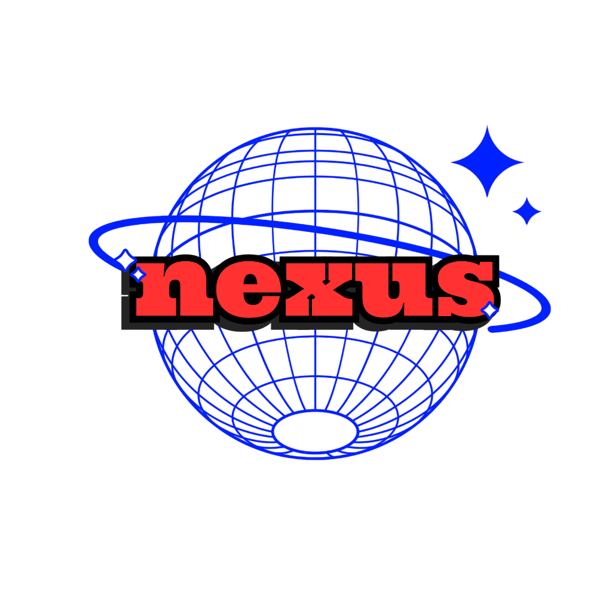

# PROJECT NEXUS — Complete Features Guide

### Comprehensive Technical & Functional Feature Specification
**Edition:** Emerald Edition (v1.1.0) &bull; **Platform:** Windows 10 & 11 (x64) &bull; **Engine:** C# 13 / .NET 11 + Rust SIMD Daemon

---

## Table of Contents

1. [Core Architectural Features](#1-core-architectural-features)
2. [Design & User Experience](#2-design--user-experience)
3. [Workspace Studios](#3-workspace-studios)
   - [3.1 Command Center Dashboard](#31-command-center-dashboard)
   - [3.2 Universal Conversion Studio](#32-universal-conversion-studio)
   - [3.3 Image Studio (Digital Darkroom)](#33-image-studio-digital-darkroom)
   - [3.4 AI Image Upscaler (Super-Resolution Studio)](#34-ai-image-upscaler-super-resolution-studio)
   - [3.5 Audio Studio (Sound Engineer Suite)](#35-audio-studio-sound-engineer-suite)
   - [3.6 Video Studio (Cinema Lab)](#36-video-studio-cinema-lab)
   - [3.7 PDF Studio (Document Publisher & Binder)](#37-pdf-studio-document-publisher--binder)
   - [3.8 Archive Manager (Compression Vault)](#38-archive-manager-compression-vault)
4. [Management Modules](#4-management-modules)
   - [4.1 Processing Center](#41-processing-center)
   - [4.2 Automation Center](#42-automation-center)
   - [4.3 Storage Analyzer](#43-storage-analyzer)
5. [Developer & Diagnostic Toolkit](#5-developer--diagnostic-toolkit)
6. [Security, Privacy & Data Integrity](#6-security-privacy--data-integrity)
7. [Keyboard Shortcuts Matrix](#7-keyboard-shortcuts-matrix)

---

## 1. Core Architectural Features

* **100% Offline-First Architecture:**
  Every operation—from media transcoding and PDF stitching to AI upscaling and cryptographic checksums—executes entirely on local machine resources. Zero bytes are uploaded to external cloud endpoints.
* **Dual-Engine Decoupled Architecture:**
  Combines an expressive C# 13 / .NET 11 WPF desktop presentation layer with a native, multithreaded Rust daemon (`nexus-engine.exe`) communicating over high-throughput Windows Named Pipes (`\\.\pipe\nexus-engine`).
* **Zero UI Latency & Thread Isolation:**
  Heavy image rendering, compression, and mathematical transformations run in background worker threads. The UI main thread never stutters, maintaining a smooth 60+ FPS experience even under multi-gigabyte loads.
* **Dual-Engine Execution Resilience:**
  If the native background daemon is offline or experiencing system permission constraints, the C# application layer automatically activates built-in high-fidelity managed fallbacks (e.g., WPF `BitmapScalingMode.Fant` sinc-sampling), ensuring 100% uninterrupted operation.
* **Transactional SQLite Storage with WAL Mode:**
  Persistent application state, job histories, watch-folder configurations, and user preferences are recorded in an embedded SQLite database using Write-Ahead Logging (WAL) for concurrent read/write throughput without file locks.
* **Microsecond-Accurate Win32 Telemetry:**
  Integrates directly with Windows kernel APIs (`GlobalMemoryStatusEx` and `GetSystemTimes`) via P/Invoke to deliver real-time CPU and RAM utilization metrics without consuming significant background CPU cycles.

---

## 2. Design & User Experience

* **Emerald Edition Visual Identity:**
  A color system combining **Deep Forest** (`#10251D`), **Graphite** (`#18231F`), **Dark Slate** (`#24332C`), **Emerald Accent** (`#10B981`), and **Mint** (`#6EE7B7`) for long working sessions without visual fatigue.
* **Dynamic Dual-Theme Engine (Obsidian Dark & Clean Light):**
  Seamlessly switch between Emerald Obsidian Dark and Emerald Clean Light mode at the click of a button or via `Ctrl+T`. Every control, container, border, and typography element dynamically updates via WPF resource dictionaries.
* **Distraction-Free Focus Mode (`F10`):**
  One-click or hotkey transition that collapses sidebars and top bars, maximizing viewport space for dedicated media inspection and batch processing.
* **Global Command Palette (`Ctrl+Shift+P` / `Ctrl+K`):**
  Universal search-as-you-type fuzzy launcher. Access any studio, trigger theme toggles, search recent files, or launch tools with keyboard-only navigation.
* **Tailored Domain UIs:**
  Each studio features a custom layout tailored to its media domain (e.g., Cinema viewport for video, Waveform stage for audio, Digital Darkroom canvas for images) rather than generic template grids.

---

## 3. Workspace Studios

### 3.1 Command Center Dashboard
* **Real-Time Hardware Telemetry:** Live meters displaying CPU usage, physical RAM consumption, and engine IPC status (`Online` / `Standby`).
* **Quick Actions Dock:** Instant 1-click launchers for the 7 primary studios directly from the main view.
* **Smart File Drop Zone:** Drop any file to trigger automatic MIME classification, magic-byte inspection, format verification, and recommended actions.
* **Processing Overview & Storage Footprint:** Overview of total files converted, active background tasks, and storage consumed.

### 3.2 Universal Conversion Studio
* **Multi-Category Ingestion:** Batch convert files across all 5 major media domains simultaneously:
  * *Images:* PNG, JPG, JPEG, WEBP, AVIF, SVG, TIFF, BMP, GIF.
  * *Audio:* MP3, WAV, FLAC, AAC, OGG, M4A, WMA.
  * *Video:* MP4, MKV, MOV, AVI, WEBM.
  * *Documents:* PDF, DOCX, TXT, ODT.
  * *Archives:* TAR.GZ, TAR, ZIP.
* **Three-Part Workspace Layout:** Left queue management, Center before-and-after inspection stage, Right encoding presets and target configuration.
* **Automated Format Recommendation:** Heuristic engine that analyzes incoming file types and suggests the most efficient modern target format (e.g., recommending WebP for raster graphics or FLAC for master audio).

### 3.3 Image Studio (Digital Darkroom)
* **Lanczos3 Sinc Resampling:** High-precision, sinc-windowed downscaling and upscaling with SIMD acceleration for sharp raster resizing.
* **Aspect-Ratio Lock:** Proportional dimension linking ensuring images retain original ratios during custom pixel resizing.
* **Quick Preset Chips:** 1-click application of standard output profiles:
  * `WebP 85% Optimized` (Compact web delivery)
  * `Lossless PNG with Alpha` (Design assets)
  * `1080p Full HD` (1920 × 1080 px)
  * `4K UHD` (3840 × 2160 px)
  * `Avatar 512` (512 × 512 px square)
  * `Thumbnail 256` (256 × 256 px)
* **EXIF & Privacy Metadata Scrubbing:** One-click removal of sensitive image metadata, including GPS coordinates, camera serial numbers, exposure info, and device identifiers.

### 3.4 AI Image Upscaler (Super-Resolution Studio)
* **2X to 8X Super-Resolution Multipliers:** High-fidelity raster magnification with presets for `2x HD`, `4x Ultra`, `8x Extreme`, `4K UHD (3840×2160)`, and `8K Master (7680×4320)`.
* **Multiple Reconstruction Algorithms:**
  * *Lanczos3 Sinc-Windowed:* High clarity and high-frequency texture recovery for natural photos and detailed renders.
  * *Catmull-Rom Bicubic Spline:* Smooth edge gradients and soft transitions ideal for portraits and digital paintings.
  * *Nearest Neighbor Integer:* Lossless, pixel-crisp 0-blur magnification designed specifically for retro sprites and pixel art.
  * *Adaptive Edge-Enhanced:* Neural-style unsharp masking pass that boosts micro-contrast without creating ringing halos.
* **Interactive Before / After Dual Stage:** Side-by-side visual viewport displaying the original image and upscaled output with live dimension and file size metrics.
* **Fine-Tuning Controls:** Micro-contrast sharpening slider (0% to 100%), chroma artifact reduction & denoise toggle, and custom output directory routing.

### 3.5 Audio Studio (Sound Engineer Suite)
* **High-Fidelity Audio Transcoding:** Convert audio between MP3, WAV, FLAC, AAC, OGG, M4A, and WMA.
* **Bitrate Matrix:** Dedicated selection pills for `320k` (Studio Master), `256k` (High Fidelity), `192k` (Balanced), `128k` (Standard), and `64k` (Voice).
* **Sample Rate Controls:** Direct frequency selection (`48000 Hz` Cinema/Broadcast, `44100 Hz` CD Audio, `96000 Hz` Hi-Res Master).
* **Visual Waveform Canvas:** Interactive audio stage displaying simulated frequency waveforms with play/pause playback controls.
* **ID3 Tag Preservation:** Preserves embedded audio metadata tags (Artist, Title, Album) across format transitions.

### 3.6 Video Studio (Cinema Lab)
* **16:9 Cinema Viewport:** Dedicated widescreen viewport for inspecting video media prior to processing.
* **Transcoding & Codec Compression:** Transcode video streams into MP4 (H.264), MKV, MOV, AVI, or WEBM.
* **Resolution Scaling Presets:** Instant downscaling or resizing to 4K Cinema (3840×2160), 1080p FHD, 720p HD, or 480p Mobile.
* **Workflow Device Profiles:**
  * *YouTube 4K Ultra* (Maximum bitrate & dynamic range)
  * *Web Stream H.264* (Fast-start MP4 with web compatibility)
  * *Discord <25MB* (Two-pass target-bitrate compression for chat uploads)
  * *Mobile Archival* (H.264 baseline for battery-efficient playback)
* **Audio Demuxing:** Extract uncompressed or high-bitrate soundtracks directly from video containers without re-encoding video tracks.

### 3.7 PDF Studio (Document Publisher & Binder)
* **Multi-Document PDF Stitching:** Merge disparate PDF documents into a single consolidated file with rebuilt cross-reference tables and linearized streams.
* **Interactive Document Staging Board:** Visual document queue with **▲ Up** and **▼ Down** buttons for reordering pages and documents before binding.
* **Custom Output Naming:** Output document naming with automated timestamp prefixes (`Bound_Document_YYYYMMDD.pdf`).
* **Client-Side Document Safety:** Operates locally without external cloud converters, protecting legal, financial, and confidential documents.

### 3.8 Archive Manager (Compression Vault)
* **Dual Vault Modes:** Tabbed interfaces for **Create Archive Vault** and **Extract Archive Package**.
* **Container Format Selection:** Full support for `.tar.gz` (GZIP compressed), `.zip` (universal compatibility), and `.tar` (uncompressed tape archive).
* **SIMD Compression Stepper:** 5 levels of compression efficiency:
  * *Store* (0% CPU, instant packaging)
  * *Fast* (Quick ratio)
  * *Normal* (Balanced default)
  * *Maximum* (High ratio LZMA2/Deflate)
  * *Ultra* (SIMD-accelerated multi-threaded compression)
* **Zip-Slip & Path Traversal Guard:** Automated security shield that sanitizes every archive entry against directory traversal attacks (CVE-2018-1002200), rejecting any attempt to write files outside the destination directory via `../` sequences.

---

## 4. Management Modules

### 4.1 Processing Center
* **Priority Queue Management:** Assign task execution priority across four tiers (`Low`, `Normal`, `High`, `Critical`) with dynamic queue reordering.
* **Real-Time Throughput Telemetry:** Live calculation of processing speed (MB/s), elapsed duration, and estimated time to completion (ETA).
* **Task Lifecycle Controls:** Pause, resume, retry failed jobs, or purge completed entries.
* **Direct File Access:** One-click "Open File in Folder" button that selects the generated output file directly in Windows File Explorer (`explorer.exe /select`).

### 4.2 Automation Center
* **Watch Folders (`FileSystemWatcher`):** Configure background directory monitors that watch specific file paths and automatically trigger conversion routines when new files arrive.
* **Conditional Rules Engine:** Route files based on extension, naming pattern, or category to specific output folders.
* **Non-Destructive Watch Ingestion:** Leaves original dropped files intact while depositing converted assets into designated output directories.

### 4.3 Storage Analyzer
* **Recursive Disk Space Scanner:** Analyzes target drives and directories to provide an accurate breakdown of space consumption.
* **Category Breakdown:** Categorizes disk allocation across Images, Video, Audio, Documents, Archives, and Code files.
* **Cleanup Recommendations:** Identifies large, uncompressed media files suitable for conversion to modern formats (e.g., converting legacy BMP/TIFF to WebP or raw WAV to FLAC).

---

## 5. Developer & Diagnostic Toolkit

* **JSON Formatter & Schema Validator:**
  * Auto-indentation (2 spaces / 4 spaces) and single-line minification.
  * Real-time JSON syntax validation with line/column error markers.
* **Base64 Encoder & Decoder:**
  * Encode raw text or binary payload into Base64 format.
  * Instant Base64 decoding with UTF-8 character preservation.
* **Cryptographic Hashing Engine:**
  * Real-time generation of **MD5**, **SHA-256**, and **SHA-512** hashes for text snippets and physical files.
* **File Checksum Verification Tool:**
  * Compare a computed hash against a publisher's reference checksum string with visual match/mismatch status indicators.
* **Binary Hex Viewer:**
  * Inspect raw binary structures with standard 16-byte row offsets, hexadecimal byte representations, and ASCII character translation.

---

## 6. Security, Privacy & Data Integrity

| Security Standard | Implementation |
|---|---|
| **Zero Cloud Exposure** | All processing occurs strictly on the local machine (`127.0.0.1` and local pipes). |
| **Path Traversal Defense** | Built-in path canonicalization checks in `nexus-utils` block Zip-Slip archive exploits. |
| **Process Isolation** | Heavy media processing runs in the isolated Rust daemon process; an unhandled decoder fault cannot crash the WPF user interface. |
| **Safe Temp Cleanup** | Intermediate processing chunks use unique GUIDs and are purged automatically on completion. |
| **Non-Destructive Operations** | Original input files are never overwritten; conversions default to distinct filenames or user-chosen output destinations. |

---

## 7. Keyboard Shortcuts Matrix

| Shortcut | Action | Description |
|---|---|---|
| `Ctrl + 1` | **Command Center** | Jump to main dashboard & live telemetry |
| `Ctrl + 2` | **Universal Studio** | Universal batch format conversion workspace |
| `Ctrl + 3` | **Image Studio** | Digital darkroom for image resizing & EXIF scrubbing |
| `Ctrl + U` | **AI Image Upscaler** | 2X, 4X, 8X SIMD super-resolution studio |
| `Ctrl + 4` | **Audio Studio** | Audio bitrate, sample rate & waveform tools |
| `Ctrl + 5` | **Video Studio** | Video transcoding, compression & cinema viewport |
| `Ctrl + 6` | **PDF Studio** | Multi-document PDF binding & page reordering |
| `Ctrl + 7` | **Archive Manager** | Compression vault & safe archive extraction |
| `Ctrl + 8` | **Developer Toolkit** | JSON, Base64, Hashes & Hex viewer |
| `Ctrl + 9` | **Processing Center** | Task queue management & throughput metrics |
| `Ctrl + ,` | **Settings & Info** | Application configuration & version details |
| `Ctrl + T` | **Toggle Theme** | Switch between Emerald Obsidian Dark & Clean Light |
| `F10` | **Focus Mode** | Toggle distraction-free full-screen stage |
| `Ctrl + B` | **Toggle Sidebar** | Expand or collapse the navigation sidebar |
| `Ctrl + Shift + P` | **Command Palette** | Global fuzzy-search tool and studio launcher |
| `Ctrl + K` | **Command Palette (Alt)** | Alternative shortcut for Command Palette |

---

  <b>PROJECT NEXUS</b> &bull; Built with precision for Windows 10 & 11

