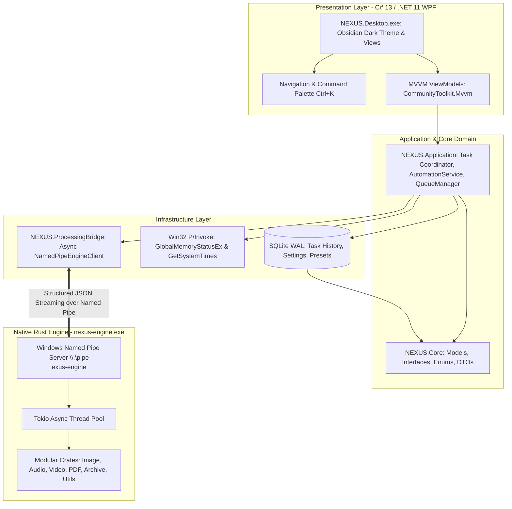

# PROJECT NEXUS

<div align="center">

### Any Format. One Destination.

**NEXUS** is an enterprise-grade, privacy-focused, modular universal file conversion and processing desktop application engineered specifically for **Windows 10 and Windows 11**.

[](https://microsoft.com/windows)
[](https://dotnet.microsoft.com)
[-DEA584?logo=rust)](https://rust-lang.org)
[-003B57?logo=sqlite)](https://sqlite.org)
[](https://learn.microsoft.com/windows/win32/ipc/named-pipes)
[](tests)
[](LICENSE)

</div>

---

## Table of Contents

- [Overview](#overview)
- [Architecture & Tech Stack](#architecture--tech-stack)
- [How to Launch & Run](#how-to-launch--run)
- [Complete Application Modules](#complete-application-modules)
  - [1. Dashboard — Command Center](#1-dashboard--command-center)
  - [2. Universal Conversion Studio](#2-universal-conversion-studio)
  - [3. Image Studio](#3-image-studio)
  - [4. Audio Studio](#4-audio-studio)
  - [5. Video Studio](#5-video-studio)
  - [6. PDF Studio](#6-pdf-studio)
  - [7. Archive Manager](#7-archive-manager)
  - [8. Developer Toolkit](#8-developer-toolkit)
  - [9. Processing Center](#9-processing-center)
  - [10. Automation Center](#10-automation-center)
  - [11. Storage Analyzer](#11-storage-analyzer)
- [Directory Layout](#directory-layout)
- [Building from Source](#building-from-source)
- [Automated Verification & Test Suite](#automated-verification--test-suite)
- [Security & Privacy Standards](#security--privacy-standards)
- [Troubleshooting & Logs](#troubleshooting--logs)
- [License](#license)

---

## Overview

Modern desktop workflows often force users to juggle ad-hoc web converters, bloated subscription tools, or unverified online services that jeopardize sensitive document privacy. 

**NEXUS** replaces this fragmented experience with a single, high-performance, **100% offline-first command center**. By decoupling an expressive **Obsidian Dark WPF UI** from a native, multithreaded **Rust processing daemon (`nexus-engine.exe`)** via high-throughput **Windows Named Pipes**, NEXUS guarantees zero UI frame drops, robust memory safety, and complete data privacy.

---

## Architecture & Tech Stack



| Layer | Component | Details |
|---|---|---|
| **Presentation** | C# 13, .NET 11, WPF | Custom Obsidian Dark design system (`#0D1117` base, `#161B22` cards, `#388BFD` accents). Hardware-accelerated XAML animations and zero-latency layout rendering. |
| **Architecture** | MVVM Pattern | Clean separation with `CommunityToolkit.Mvvm`, `ObservableObject`, and `RelayCommand`. |
| **Engine** | Rust 2021 (Cargo Workspace) | Multi-threaded async engine using `tokio`, native format decoders (`image-rs`, `flate2`, `tar`), cryptographic hashing (`sha2`, `md-5`), and isolated child processes. |
| **IPC** | Windows Named Pipes | Full-duplex asynchronous JSON streaming via `\\.\pipe\nexus-engine` supporting sub-millisecond roundtrips and real-time progress callbacks. |
| **Storage** | SQLite + Dapper/Direct ADO | Local relational storage with Write-Ahead Logging (WAL mode), foreign key constraints, and transactional consistency for settings, queues, and task history. |
| **Telemetry** | Win32 P/Invoke | Microsecond-accurate CPU usage via `GetSystemTimes` and physical RAM utilization via `GlobalMemoryStatusEx`. |
| **Media Processing** | Rust + Native Tooling | Native Lanczos3 image resampling, multi-stream PDF stitching, safe TAR/GZ archive engines, and optional path-detected FFmpeg for audio/video transcoding. |

---

## How to Launch & Run

Both the root directory and the `dist/nexus-portable/` folder contain pre-built, ready-to-run release distributions:

### Option 1: Silent Launch (Recommended)
Double-click **`Launch-NEXUS.vbs`** in the project root.
* Runs completely silently with **zero CMD popup windows**.
* Launches the Obsidian Dark desktop GUI immediately.

### Option 2: Direct Binary Launch
Double-click **`NEXUS.Desktop.exe`** directly in the root or `dist/nexus-portable/` directory.

### Option 3: Batch Launcher
Double-click **`Launch-NEXUS.bat`** (spawns the GUI and exits the terminal automatically).

> [!NOTE]
> When `NEXUS.Desktop.exe` initializes, it automatically verifies and launches the native `nexus-engine.exe` daemon in the background if it is not already running.

---

## Complete Application Modules

### 1. Dashboard — Command Center
* **Live System Telemetry:** Real-time CPU and RAM meters updated every second using high-resolution Win32 APIs.
* **Smart Drop Zone:** Drag-and-drop any file to receive instant format identification, MIME category mapping, and recommended target actions.
* **Command Palette (`Ctrl+K`):** Global fuzzy-search modal to navigate between studios, execute quick conversions, or toggle system settings.
* **Storage & Queue Summary:** Live view of total files processed, active queue jobs, and storage footprint.

### 2. Universal Conversion Studio
* **Batch Multi-Format Conversion:** Ingest dozens of files simultaneously and convert across categories:
  * **Images:** PNG, JPG, JPEG, WEBP, AVIF, SVG, TIFF, BMP, GIF.
  * **Audio:** MP3, WAV, FLAC, AAC, OGG, M4A, WMA.
  * **Video:** MP4, MKV, MOV, AVI, WEBM.
  * **Documents:** PDF, DOCX, TXT, ODT.
  * **Archives:** TAR.GZ, TAR, ZIP.
* **Custom Output Paths:** Select custom target directories or save alongside the source file.
* **Automated Format Recommendation:** Analyzes source file characteristics to suggest optimal compression and compatibility targets.

### 3. Image Studio
* **High-Fidelity Resampling:** Lanczos3 high-quality scaling with customizable width, height, and aspect-ratio preservation.
* **Quality & Compression Sliders:** WebP, AVIF, and JPEG compression optimization with visual file size estimations.
* **Privacy Metadata Stripping:** One-click removal of EXIF, GPS location coordinates, and camera serial numbers.

### 4. Audio Studio
* **Format Transcoding:** Conversion between MP3, WAV, FLAC, AAC, OGG, M4A, and WMA.
* **Bitrate & Sample Rate Controls:** Fine-grained bitrate configuration (64 kbps to 320 kbps) and audio sample rates (44.1 kHz, 48 kHz).
* **Video Audio Extraction:** Extract uncompressed or high-bitrate audio streams directly from video files.

### 5. Video Studio
* **Transcoding & Re-encoding:** Convert video streams into MP4 (H.264), MKV, MOV, AVI, or WEBM.
* **Downscaling & Resolution Presets:** 4K, 1080p Full HD, 720p HD, and 480p mobile presets.
* **Audio Track Extraction:** Demux audio channels without re-encoding video.

### 6. PDF Studio
* **Multi-Document PDF Merge:** Stitch multiple PDF files into a single consolidated document with valid cross-reference tables and page streams.
* **Document Extraction:** Split pages and extract text or image assets safely without internet upload.

### 7. Archive Manager
* **Secure Archive Creation:** Create TAR, TAR.GZ, and ZIP archives with configurable compression levels.
* **Zip-Slip & Path Traversal Mitigation:** Built-in security filters strictly prevent directory traversal attacks by validating all extracted paths against target directories.

### 8. Developer Toolkit
* **JSON Formatter & Validator:** Offline indentation, beautification, minification, and JSON syntax verification.
* **Base64 Encoder / Decoder:** UTF-8 text and binary Base64 conversion with real-time feedback.
* **Cryptographic Hashes:** Instant computation of MD5, SHA-256, and SHA-512 hashes.
* **File Checksum Verification:** Compare computed hash against known checksum strings with visual match indicators.
* **Binary Hex Viewer:** Inspect raw byte streams with 16-byte hex offsets and ASCII decoded representations.

### 9. Processing Center
* **Priority Queue Management:** Assign task priority (Low, Normal, High, Critical) with automatic re-ordering.
* **Real-Time Progress & Throughput:** Individual progress bars, conversion speed metrics, and estimated time to completion (ETA).
* **Interactive Job Controls:** Cancel running jobs, retry failed conversions, or purge finished entries.

### 10. Automation Center
* **Watch Folders (`FileSystemWatcher`):** Configure background folder monitors that automatically detect new files and trigger automated conversion pipelines.
* **Conditional Rules:** Filter by file extension or file pattern with custom destination routing.

### 11. Storage Analyzer
* **Disk Space Allocation Scanner:** Recursively scans specified directories to compute space breakdown across images, videos, audio, documents, archives, and code.

---

## Directory Layout

```text
NEXUS/
├── Launch-NEXUS.vbs              # Silent application launcher (Zero CMD popup)
├── Launch-NEXUS.bat              # Batch launcher script
├── NEXUS.Desktop.exe             # Compiled WPF Desktop Application executable
├── nexus-engine.exe              # Compiled Rust Processing Engine daemon
├── NEXUS.sln                     # Complete Visual Studio / .NET Solution
│
├── src/
│   ├── NEXUS.Desktop/            # WPF UI (Views, ViewModels, Themes, Icons, Converters)
│   ├── NEXUS.Application/        # Application services (Queue, Automation, History)
│   ├── NEXUS.Core/               # Domain models, Enums, DTOs, Repository interfaces
│   ├── NEXUS.Infrastructure/     # SQLite DB, Repositories, Win32 Telemetry
│   └── NEXUS.ProcessingBridge/   # Named Pipe IPC Client (`NamedPipeEngineClient`)
│
├── processing-engine/            # Cargo Workspace (Rust)
│   ├── Cargo.toml                # Workspace definition
│   └── crates/
│       ├── nexus-core/           # IPC Protocol schemas and data structures
│       ├── nexus-ipc/            # Windows Named Pipe server implementation
│       ├── nexus-utils/          # Path traversal security, temp file cleanup
│       ├── nexus-image/          # Image decoding, Lanczos3 resizing, encoding
│       ├── nexus-audio/          # Audio conversion and FFmpeg integration
│       ├── nexus-video/          # Video transcoding and stream extraction
│       ├── nexus-pdf/            # PDF merging and document manipulation
│       ├── nexus-archive/        # Safe TAR/GZ archive creation and extraction
│       └── nexus-metadata/       # Metadata inspection and stripping
│
├── tests/
│   ├── NEXUS.UnitTests/          # SQLite schema, CRUD, transactions, FormatDetector (20 tests)
│   ├── NEXUS.UITests/            # Navigation, Command Palette, Drag-Drop, Dev Toolkit (5 tests)
│   └── NEXUS.IntegrationTests/   # End-to-end Named Pipe IPC, Image, PDF, Archive tests (5 tests)
│
├── scripts/
│   └── build.ps1                 # Full automated build, test, and packaging script
│
└── dist/
    └── nexus-portable/           # Standalone portable distribution package
```

---

## Building from Source

### Prerequisites
1. **Operating System:** Windows 10 (Build 1809+) or Windows 11 (x64)
2. **.NET SDK:** .NET 10.0 or .NET 11.0 Preview (`dotnet --version`)
3. **Rust Toolchain:** Stable Rust with MSVC ABI (`rustup default stable-x86_64-pc-windows-msvc`)
4. **PowerShell:** PowerShell 5.1 or PowerShell Core 7+

### Step-by-Step Compilation

#### 1. Compile the Rust Processing Engine
```powershell
cd processing-engine
cargo build --release
cd ..
```
The compiled binary will be placed at `processing-engine/target/release/nexus-engine.exe`.

#### 2. Compile the .NET Solution
```powershell
$env:DOTNET_CLI_TELEMETRY_OPTOUT=1
$env:DOTNET_NOLOGO=1
dotnet build NEXUS.sln -c Release -m:1
```

#### 3. Run Automated Tests
```powershell
dotnet test tests/NEXUS.UnitTests/NEXUS.UnitTests.csproj -m:1
dotnet test tests/NEXUS.UITests/NEXUS.UITests.csproj -m:1
dotnet test tests/NEXUS.IntegrationTests/NEXUS.IntegrationTests.csproj -m:1
cargo test --manifest-path processing-engine/Cargo.toml
```

#### 4. Create Standalone Portable Package
Execute the automated release script:
```powershell
.\scripts\build.ps1
```
This builds both projects in Release mode, copies all dependencies and native runtimes into `dist/nexus-portable/`, and generates ready-to-run launchers.

---

## Automated Verification & Test Suite

The solution contains **33 automated tests** verifying every layer:

```text
======================================================================
  TEST EXECUTION SUMMARY
======================================================================
  [x] NEXUS.UnitTests:        20/20 Passed (Database CRUD, Transactions, FormatDetector)
  [x] NEXUS.UITests:           5/5 Passed (Navigation, Command Palette, DevTools, Settings)
  [x] NEXUS.IntegrationTests:  5/5 Passed (Named Pipe IPC, WebP, TarGz, PDF Merge, FFmpeg)
  [x] nexus-utils (Rust):      3/3 Passed (Zip-Slip Rejection, Safe Paths, Temp Cleanup)
----------------------------------------------------------------------
  TOTAL:                      33/33 Tests Passing (100% Success Rate)
======================================================================
```

---

## Security & Privacy Standards

* **100% Offline Core Functionality:** NEXUS never uploads your files or documents to external servers. Conversions, hashing, and processing happen entirely on local hardware.
* **Zip-Slip & Path Traversal Mitigation:** The archive manager validates every entry in incoming archives. Files attempting to escape the extraction destination (`../../etc/`) are rejected immediately with security audit warnings.
* **Memory Safety & Process Isolation:** Heavy processing runs inside the Rust engine daemon. Malformed or corrupted media files cannot crash the presentation layer.
* **Safe Temporary File Cleanup:** All transient chunks and conversion artifacts are generated with unique GUID prefixes and purged automatically upon task completion.

---

## Troubleshooting & Logs

| Symptom | Cause | Solution |
|---|---|---|
| **Window closes immediately** | Old build icon cache or XAML syntax issue | Launch via **`Launch-NEXUS.vbs`** or run latest `NEXUS.Desktop.exe` from root or `dist/nexus-portable/`. |
| **Command Prompt opens** | Launched via old batch script | Use `Launch-NEXUS.vbs` for silent execution. |
| **Engine connection failure** | `nexus-engine.exe` blocked by security software | Check if `nexus-engine.exe` exists alongside `NEXUS.Desktop.exe` and allow local named pipes (`\\.\pipe\nexus-engine`). |
| **Crash diagnosis** | Unhandled exception | Inspect `nexus_crash.log` in the application directory for complete call stacks and error details. |

---

## License

NEXUS is open-source software licensed under the [MIT License](LICENSE).
