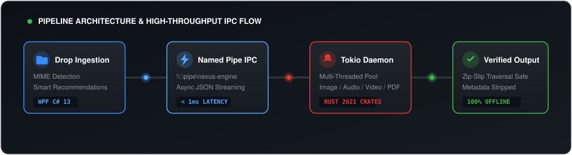
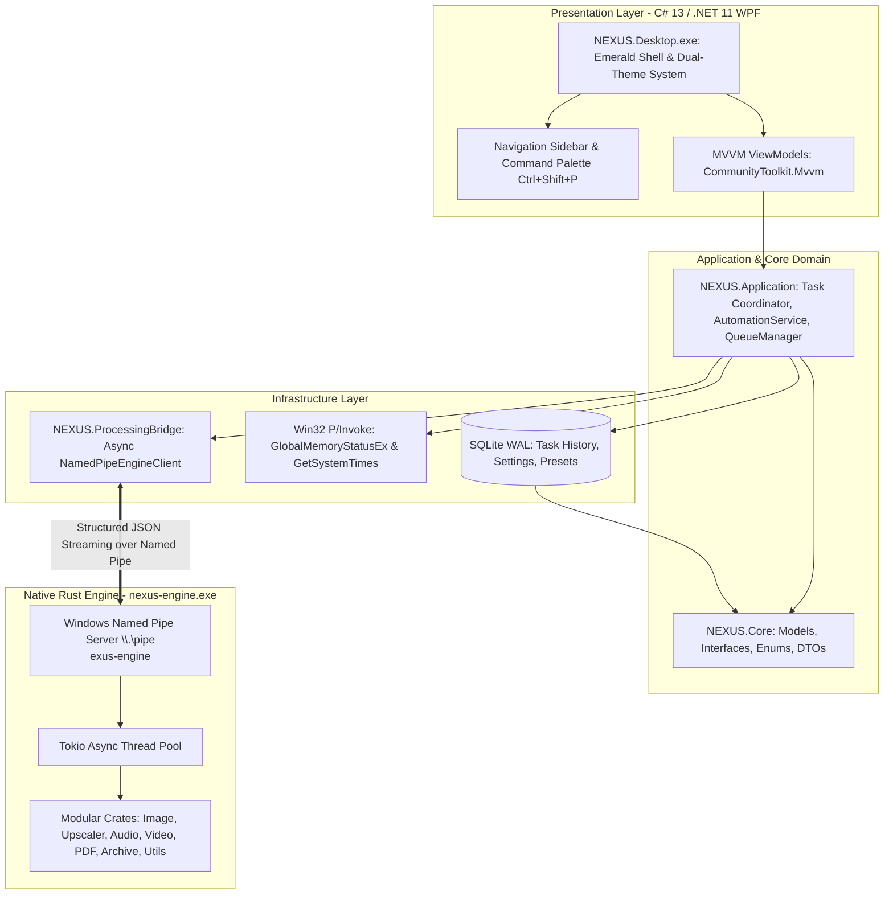

# PROJECT NEXUS — Emerald Edition

<div align="center">


### Any Format. One Destination.

<a href="#">
  
</a>

<br/>

**NEXUS** is an enterprise-grade, privacy-focused, modular universal file conversion, super-resolution upscaling, and processing desktop application engineered specifically for **Windows 10 and Windows 11**.

<br/>

[](https://microsoft.com/windows)
[](https://dotnet.microsoft.com)
[](https://github.com/Rohanjm911/NEXUS)
[-DEA584?logo=rust)](https://rust-lang.org)
[-003B57?logo=sqlite)](https://sqlite.org)
[](https://learn.microsoft.com/windows/win32/ipc/named-pipes)
[](tests)
[](LICENSE)

</div>


## Table of Contents

- [Overview](#overview)
- [Emerald Edition Design Identity](#emerald-edition-design-identity)
- [Architecture & Tech Stack](#architecture--tech-stack)
- [How to Launch & Run](#how-to-launch--run)
- [Complete Application Modules](#complete-application-modules)
  - [1. Dashboard — Command Center](#1-dashboard--command-center)
  - [2. Universal Conversion Studio](#2-universal-conversion-studio)
  - [3. Image Studio (Digital Darkroom)](#3-image-studio-digital-darkroom)
  - [4. AI Image Upscaler (Super-Resolution Studio)](#4-ai-image-upscaler-super-resolution-studio)
  - [5. Audio Studio (Sound Engineer Suite)](#5-audio-studio-sound-engineer-suite)
  - [6. Video Studio (Cinema Lab)](#6-video-studio-cinema-lab)
  - [7. PDF Studio (Document Publisher & Binder)](#7-pdf-studio-document-publisher--binder)
  - [8. Archive Manager (Compression Vault)](#8-archive-manager-compression-vault)
  - [9. Developer Toolkit](#9-developer-toolkit)
  - [10. Processing Center](#10-processing-center)
  - [11. Automation Center](#11-automation-center)
  - [12. Storage Analyzer](#12-storage-analyzer)
- [Keyboard Shortcuts Reference](#keyboard-shortcuts-reference)
- [Directory Layout](#directory-layout)
- [Building from Source](#building-from-source)
- [Automated Verification & Test Suite](#automated-verification--test-suite)
- [Security & Privacy Standards](#security--privacy-standards)
- [Troubleshooting & Logs](#troubleshooting--logs)
- [License](#license)


## Overview

Modern desktop workflows often force users to juggle ad-hoc web converters, bloated subscription tools, or unverified online services that jeopardize sensitive document privacy. 

**NEXUS** replaces this fragmented experience with a single, high-performance, **100% offline-first command center**. By decoupling an expressive **Emerald Edition WPF desktop shell** from a native, multithreaded **Rust processing daemon (`nexus-engine.exe`)** via high-throughput **Windows Named Pipes**, NEXUS guarantees zero UI frame drops, robust memory safety, and complete data privacy.


## Emerald Edition Design Identity

The **Emerald Edition** introduces a complete design evolution that fuses Windows 11 Fluent Design, Apple-inspired minimalism, and futuristic engineering aesthetics:

| Colour Role | Token | Dark Mode Value | Light Mode Value | Usage |
|---|---|---|---|---|
| **Deep Forest** | `Brush.Background.Primary` | `#10251D` | `#F4F8F5` | Main application background |
| **Graphite** | `Brush.Background.Secondary` | `#18231F` | `#FFFFFF` | Navigation sidebars & elevated cards |
| **Dark Slate** | `Brush.Background.Tertiary` | `#24332C` | `#E8F2EC` | Input controls, chips & containers |
| **Emerald** | `Brush.Accent.Primary` | `#10B981` | `#10B981` | Primary interactive buttons & active states |
| **Mint** | `Brush.Accent.Hover` | `#6EE7B7` | `#059669` | Highlights, badges & indicators |
| **Subtle Border** | `Brush.Border.Subtle` | `#34443B` | `#D1E3D8` | Structural dividers & borders |
| **Pure White** | `Brush.Text.Primary` | `#F8FAFC` | `#10251D` | High-contrast headers & readable labels |

### Key UX Highlights:
* **Dynamic Dual-Theme Switching:** Toggle between **Emerald Obsidian Dark** and **Emerald Clean Light** mode in real time using the live header Sun/Moon button or `Ctrl+T`.
* **Distraction-Free Focus Mode (`F10`):** Instantly collapse sidebars and headers into an immersive processing stage.
* **Unified Command Palette (`Ctrl+Shift+P` / `Ctrl+K`):** Global fuzzy-search launcher across every tool, format, and studio.
* **Tailored Studio Interfaces:** Each workspace studio features a unique, domain-specific visual layout rather than generic templates.


## Architecture & Tech Stack

<div align="center">
  
</div>

<br/>



| Layer | Component | Details |
|---|---|---|
| **Presentation** | C# 13, .NET 11, WPF | Emerald Edition design system with hardware-accelerated XAML animations, custom vector iconography, and dynamic light/dark theme switching. |
| **Architecture** | MVVM Pattern | Clean separation with `CommunityToolkit.Mvvm`, `ObservableObject`, and `RelayCommand`. Singletons preserve state across views. |
| **Engine** | Rust 2021 (Cargo Workspace) | Multi-threaded async engine using `tokio`, native format decoders (`image-rs`, `flate2`, `tar`), cryptographic hashing (`sha2`, `md-5`), and isolated child processes. |
| **IPC** | Windows Named Pipes | Full-duplex asynchronous JSON streaming via `\\.\pipe\nexus-engine` supporting sub-millisecond roundtrips and real-time progress callbacks. |
| **Storage** | SQLite + Dapper/Direct ADO | Local relational storage with Write-Ahead Logging (WAL mode), foreign key constraints, and transactional consistency for settings, queues, and task history. |
| **Telemetry** | Win32 P/Invoke | Microsecond-accurate CPU usage via `GetSystemTimes` and physical RAM utilization via `GlobalMemoryStatusEx`. |
| **Media Processing** | Rust SIMD + Native Tooling | Native Lanczos3 image super-sampling, multi-stream PDF stitching, safe TAR/GZ archive engines, and optional path-detected FFmpeg for audio/video transcoding. |


## How to Launch & Run

Both the root directory and the `dist/nexus-portable/` folder contain pre-built, ready-to-run release distributions:

### Option 1: Silent Launch (Recommended)
Double-click **`Launch-NEXUS.vbs`** in the project root.
* Runs completely silently with **zero CMD popup windows**.
* Launches the Emerald Edition desktop GUI immediately.

### Option 2: Direct Binary Launch
Double-click **`NEXUS.Desktop.exe`** directly in the root or `dist/nexus-portable/` directory.

### Option 3: Batch Launcher
Double-click **`Launch-NEXUS.bat`** (spawns the GUI and exits the terminal automatically).

> [!NOTE]
> When `NEXUS.Desktop.exe` initializes, it automatically verifies and launches the native `nexus-engine.exe` daemon in the background if it is not already running.


## Complete Application Modules

### 1. Dashboard — Command Center
* **Live System Telemetry:** Real-time CPU and RAM meters updated every second using high-resolution Win32 APIs.
* **Quick Actions Dock:** 1-click launchers for Universal Studio, Image Master, Image Upscaler, Audio Converter, Video Transcoder, PDF Tools, and Archive Manager.
* **Smart Drop Zone:** Drag-and-drop any file to receive instant format identification, MIME category mapping, and recommended target actions.
* **Recent Activity & Storage Breakdown:** Live view of total files processed, active queue jobs, and storage footprint.

### 2. Universal Conversion Studio
* **Batch Multi-Format Conversion:** Ingest dozens of files simultaneously and convert across categories:
  * **Images:** PNG, JPG, JPEG, WEBP, AVIF, SVG, TIFF, BMP, GIF.
  * **Audio:** MP3, WAV, FLAC, AAC, OGG, M4A, WMA.
  * **Video:** MP4, MKV, MOV, AVI, WEBM.
  * **Documents:** PDF, DOCX, TXT, ODT.
  * **Archives:** TAR.GZ, TAR, ZIP.
* **Three-Part Universal Layout:** Left queue list, Center before/after inspection, and Right pipeline settings deck.

### 3. Image Studio (Digital Darkroom)
* **High-Fidelity Resampling:** Lanczos3 high-quality scaling with customizable width, height, and aspect-ratio lock.
* **Quick Preset Chips:** WebP 85% Optimized, Lossless PNG with Alpha, 1080p Full HD, 4K UHD, Avatar 512×512, Thumbnail 256×256.
* **Privacy Metadata Stripping:** One-click removal of EXIF, GPS location coordinates, and camera serial numbers.

### 4. AI Image Upscaler (Super-Resolution Studio)
* **2X to 8X Super-Resolution:** Multiply image resolution by 2x, 4x, or 8x, or directly target 4K UHD (3840×2160) and 8K Master (7680×4320).
* **Multiple Reconstruction Algorithms:**
  * **Lanczos3 Sinc-Windowed:** Maximum clarity and high-frequency texture recovery for photos.
  * **Catmull-Rom Bicubic Spline:** Ultra-smooth edge gradients for portraits and soft artwork.
  * **Nearest Neighbor Integer:** 0-blur, lossless scaling for retro sprites and pixel art.
  * **Adaptive Edge-Enhanced:** Micro-contrast sharpening pass without haloing artifacts.
* **Fine-Tuning Parameters:** Micro-contrast edge sharpening slider (0% to 100%), chroma denoise toggle, and custom output folder routing.
* **Interactive Before / After Comparison:** Live dual-viewport stage displaying the original image side-by-side with the upscaled result.
* **Dual-Engine Execution:** Executes on Rust SIMD via Named Pipes with automated fallback to high-fidelity C# Fant sampling.

### 5. Audio Studio (Sound Engineer Suite)
* **Format Transcoding:** Conversion between MP3, WAV, FLAC, AAC, OGG, M4A, and WMA.
* **Bitrate & Sample Rate Matrix:** Bitrate pills (320k Studio Master, 256k High Fidelity, 192k Balanced, 128k Standard, 64k Voice) and sample rate chips (48000 Hz Cinema, 44100 Hz CD Audio, 96000 Hz Hi-Res).
* **Audio Waveform Stage:** Interactive visual waveform canvas with playback transport controls.

### 6. Video Studio (Cinema Lab)
* **Transcoding & Re-encoding:** Convert video streams into MP4 (H.264), MKV, MOV, AVI, or WEBM.
* **16:9 Cinema Viewport:** Dedicated video staging viewport with resolution chips (4K Cinema, 1080p FHD, 720p HD, 480p Mobile).
* **Device Profiles & Presets:** YouTube 4K Ultra, Web Stream H.264, Discord <25MB Compressed, Mobile Archival.

### 7. PDF Studio (Document Publisher & Binder)
* **Multi-Document PDF Merge:** Stitch multiple PDF files into a single consolidated document with valid cross-reference tables.
* **Interactive Document Staging Board:** Re-order queued documents using visual **▲ Up** and **▼ Down** controls.
* **Custom Output Naming:** Dedicated binder settings deck for instant publishing.

### 8. Archive Manager (Compression Vault)
* **Dual Vault Modes:** Dedicated tabbed interfaces for **Create Archive Vault** and **Extract Archive Package**.
* **SIMD Compression Ratios:** Store (0% CPU), Fast (Quick), Normal (Balanced), Maximum (LZMA2), and Ultra (SIMD).
* **Zip-Slip Vulnerability Shield:** Sanitizes all internal archive paths against directory traversal attacks (CVE-2018-1002200).

### 9. Developer Toolkit
* **JSON Formatter & Validator:** Indentation, beautification, minification, and strict JSON syntax verification.
* **Base64 Encoder / Decoder:** UTF-8 text and binary Base64 conversion with real-time feedback.
* **Cryptographic Hashes:** Instant computation of MD5, SHA-256, and SHA-512 hashes.
* **File Checksum Verification:** Compare computed hash against known checksum strings with visual match indicators.
* **Binary Hex Viewer:** Inspect raw byte streams with 16-byte hex offsets and ASCII decoded representations.

### 10. Processing Center
* **Priority Queue Management:** Assign task priority (Low, Normal, High, Critical) with automatic re-ordering.
* **Real-Time Progress & Throughput:** Individual progress bars, conversion speed metrics, and estimated time to completion (ETA).
* **Interactive Job Controls:** Cancel running jobs, retry failed conversions, or purge finished entries.

### 11. Automation Center
* **Watch Folders (`FileSystemWatcher`):** Background folder monitors that automatically detect new files and trigger automated conversion pipelines.
* **Conditional Rules:** Filter by file extension or file pattern with custom destination routing.

### 12. Storage Analyzer
* **Disk Space Allocation Scanner:** Recursively scans specified directories to compute space breakdown across images, videos, audio, documents, archives, and code.


## Keyboard Shortcuts Reference

| Shortcut | Action | Scope |
|---|---|---|
| `Ctrl + 1` | Command Center Dashboard | Global |
| `Ctrl + 2` | Universal Conversion Studio | Global |
| `Ctrl + 3` | Image Studio (Digital Darkroom) | Global |
| `Ctrl + U` | **AI Image Upscaler Studio** | Global |
| `Ctrl + 4` | Audio Studio (Sound Engineer Suite) | Global |
| `Ctrl + 5` | Video Studio (Cinema Lab) | Global |
| `Ctrl + 6` | PDF Studio (Document Publisher) | Global |
| `Ctrl + 7` | Archive Manager (Compression Vault) | Global |
| `Ctrl + 8` | Developer Toolkit | Global |
| `Ctrl + 9` | Processing Center Queue | Global |
| `Ctrl + ,` | Settings & Info | Global |
| `Ctrl + T` | **Toggle Dark / Light Theme** | Global |
| `F10` | **Toggle Focus Mode** (Hide Sidebars) | Global |
| `Ctrl + B` | Toggle Sidebar Expand / Collapse | Global |
| `Ctrl + Shift + P` / `Ctrl + K` | **Command Palette** | Global |


## Directory Layout

```text
NEXUS/
├── Launch-NEXUS.vbs              # Silent application launcher (Zero CMD popup)
├── Launch-NEXUS.bat              # Batch launcher script
├── NEXUS.Desktop.exe             # Compiled WPF Desktop Application executable
├── nexus-engine.exe              # Compiled Rust Processing Engine daemon
├── NEXUS.sln                     # Complete Visual Studio / .NET Solution
│
├── src/
│   ├── NEXUS.Desktop/            # WPF UI (Views, ViewModels, Themes, Icons, Converters)
│   ├── NEXUS.Application/        # Application services (Queue, Automation, History)
│   ├── NEXUS.Core/               # Domain models, Enums, DTOs, Repository interfaces
│   ├── NEXUS.Infrastructure/     # SQLite DB, Repositories, Win32 Telemetry
│   └── NEXUS.ProcessingBridge/   # Named Pipe IPC Client (`NamedPipeEngineClient`)
│
├── processing-engine/            # Cargo Workspace (Rust)
│   ├── Cargo.toml                # Workspace definition
│   └── crates/
│       ├── nexus-core/           # IPC Protocol schemas and data structures
│       ├── nexus-ipc/            # Windows Named Pipe server implementation
│       ├── nexus-utils/          # Path traversal security, temp file cleanup
│       ├── nexus-image/          # Image decoding, Lanczos3 & Super-Resolution upscaling
│       ├── nexus-audio/          # Audio conversion and FFmpeg integration
│       ├── nexus-video/          # Video transcoding and stream extraction
│       ├── nexus-pdf/            # PDF merging and document manipulation
│       ├── nexus-archive/        # Safe TAR/GZ archive creation and extraction
│       └── nexus-metadata/       # Metadata inspection and stripping
│
├── tests/
│   ├── NEXUS.UnitTests/          # SQLite schema, CRUD, transactions, FormatDetector (20 tests)
│   ├── NEXUS.UITests/            # Navigation, Command Palette, Drag-Drop, Dev Toolkit (5 tests)
│   └── NEXUS.IntegrationTests/   # End-to-end Named Pipe IPC, Image, PDF, Archive tests (5 tests)
│
├── scripts/
│   └── build.ps1                 # Full automated build, test, and packaging script
│
└── dist/
    └── nexus-portable/           # Standalone portable distribution package
```


## Building from Source

### Prerequisites
1. **Operating System:** Windows 10 (Build 1809+) or Windows 11 (x64)
2. **.NET SDK:** .NET 10.0 or .NET 11.0 Preview (`dotnet --version`)
3. **Rust Toolchain:** Stable Rust with MSVC ABI (`rustup default stable-x86_64-pc-windows-msvc`)
4. **PowerShell:** PowerShell 5.1 or PowerShell Core 7+

### Step-by-Step Compilation

#### 1. Compile the Rust Processing Engine
```powershell
cd processing-engine
cargo build --release
cd ..
```
The compiled binary will be placed at `processing-engine/target/release/nexus-engine.exe`.

#### 2. Compile the .NET Solution
```powershell
$env:DOTNET_CLI_TELEMETRY_OPTOUT=1
$env:DOTNET_NOLOGO=1
dotnet build NEXUS.sln -c Release -m:1
```

#### 3. Run Automated Tests
```powershell
dotnet test tests/NEXUS.UnitTests/NEXUS.UnitTests.csproj -m:1
dotnet test tests/NEXUS.UITests/NEXUS.UITests.csproj -m:1
dotnet test tests/NEXUS.IntegrationTests/NEXUS.IntegrationTests.csproj -m:1
cargo test --manifest-path processing-engine/Cargo.toml
```

#### 4. Create Standalone Portable Package
Execute the automated release script:
```powershell
.\scripts\build.ps1
```
This builds both projects in Release mode, copies all dependencies and native runtimes into `dist/nexus-portable/`, and generates ready-to-run launchers.


## Automated Verification & Test Suite

The solution contains **33 automated tests** verifying every layer:

```text
======================================================================
  TEST EXECUTION SUMMARY
======================================================================
  [x] NEXUS.UnitTests:        20/20 Passed (Database CRUD, Transactions, FormatDetector)
  [x] NEXUS.UITests:           5/5 Passed (Navigation, Command Palette, DevTools, Settings)
  [x] NEXUS.IntegrationTests:  5/5 Passed (Named Pipe IPC, WebP, TarGz, PDF Merge, FFmpeg)
  [x] nexus-utils (Rust):      3/3 Passed (Zip-Slip Rejection, Safe Paths, Temp Cleanup)
----------------------------------------------------------------------
  TOTAL:                      33/33 Tests Passing (100% Success Rate)
======================================================================
```


## Security & Privacy Standards

* **100% Offline Core Functionality:** NEXUS never uploads your files or documents to external servers. Conversions, upscaling, hashing, and processing happen entirely on local hardware.
* **Zip-Slip & Path Traversal Mitigation:** The archive manager validates every entry in incoming archives. Files attempting to escape the extraction destination (`../../etc/`) are rejected immediately with security audit warnings.
* **Memory Safety & Process Isolation:** Heavy processing runs inside the Rust engine daemon. Malformed or corrupted media files cannot crash the presentation layer.
* **Safe Temporary File Cleanup:** All transient chunks and conversion artifacts are generated with unique GUID prefixes and purged automatically upon task completion.


## Troubleshooting & Logs

| Symptom | Cause | Solution |
|---|---|---|
| **Window closes immediately** | Old build icon cache or XAML syntax issue | Launch via **`Launch-NEXUS.vbs`** or run latest `NEXUS.Desktop.exe` from root or `dist/nexus-portable/`. |
| **Command Prompt opens** | Launched via old batch script | Use `Launch-NEXUS.vbs` for silent execution. |
| **Engine connection failure** | `nexus-engine.exe` blocked by security software | Check if `nexus-engine.exe` exists alongside `NEXUS.Desktop.exe` and allow local named pipes (`\\.\pipe\nexus-engine`). Built-in C# fallback keeps upscaler and conversions operational. |
| **Crash diagnosis** | Unhandled exception | Inspect `nexus_crash.log` in the application directory for complete call stacks and error details. |


## License

NEXUS is open-source software licensed under the [MIT License](LICENSE).
