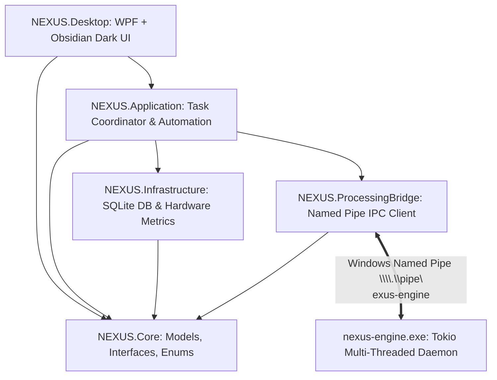

# PROJECT NEXUS

### Any Format. One Destination.

**NEXUS** is a premium, privacy-focused, modular universal file conversion and processing desktop application designed specifically for **Windows 10 and Windows 11**.

Built with a high-performance **C# / .NET 11 WPF** presentation layer styled in custom **Obsidian Dark** and backed by a native **Rust multi-crate processing engine** communicating over **Windows Named Pipes (`\\.\pipe\nexus-engine`)**, NEXUS provides a fast, offline-first command center for all file processing workflows.

---

## Key Features & Studios

### 1. Dashboard — Command Center
- **System Telemetry:** Real-time microsecond CPU and RAM usage powered by Win32 P/Invoke (`GlobalMemoryStatusEx` and `GetSystemTimes`), live disk speed, and active throughput metrics.
- **Drag-and-Drop Drop Zone:** Immediate format detection and automatic conversion recommendations.
- **Recent Processing Activity:** Live status indicators, file size comparisons, and quick launchers.
- **Command Palette (`Ctrl+K`):** Global fuzzy-search launcher across all modules and actions.

### 2. Universal Conversion Studio
- Batch conversion across 5 major categories:
  - **Images:** PNG, JPG, JPEG, WEBP, AVIF, SVG, TIFF, BMP, GIF.
  - **Audio:** MP3, WAV, FLAC, AAC, OGG, M4A, WMA.
  - **Video:** MP4, MKV, MOV, AVI, WEBM.
  - **Documents:** PDF, TXT, DOCX, ODT.
  - **Archives:** TAR.GZ, TAR, ZIP.
- Multi-file queue with target format selection and validation.

### 3. Image Studio
- High-performance Lanczos3 resizing and resolution adjustments.
- Quality compression slider and WebP/AVIF optimizations.
- EXIF, GPS, and camera metadata stripping for privacy protection.

### 4. Audio Studio
- Audio format conversion, bitrate selection (up to 320 kbps), and sample rate adjustment (44.1 kHz, 48 kHz, etc.) via dedicated FFmpeg pipeline.

### 5. Video Studio
- Video transcoding, resolution scaling (1080p, 720p, etc.), compression, and audio stream extraction.

### 6. PDF Studio
- Multi-document PDF merging, stream stitching, and container validation.

### 7. Archive Manager
- TAR.GZ, TAR, and ZIP archive creation.
- Zip-Slip and path traversal mitigation protecting against malicious relative archive paths (`../`).

### 8. Developer Toolkit
- Offline JSON Formatter & strict Schema Validator.
- Base64 Encoder & Decoder.
- Cryptographic Hashing: MD5, SHA-256, SHA-512.
- File Checksum Verification Reports.
- Hex Viewer with offset, hex bytes, and ASCII representation.

### 9. Processing Center
- Centralized task queue management with priority levels (Low, Normal, High, Critical).
- Real-time progress bars, throughput speeds, and completion estimations.
- Interactive Cancel and Retry controls for any task.

### 10. Automation Center
- Background Watch Folders powered by `FileSystemWatcher`.
- Automated format detection and conversion pipelines upon file creation.
- Toggle and remove controls with recursive folder monitoring.

### 11. Storage Analyzer
- Recursive storage breakdown scanner analyzing disk space allocation across file categories.

---

## Technology Stack

| Layer | Technology |
|---|---|
| **Desktop UI** | C# 13, .NET 11, WPF, XAML, MVVM Architecture, CommunityToolkit.Mvvm |
| **Design System** | Custom Obsidian Dark (`#0D1117` base, `#161B22` cards, `#388BFD` accents) |
| **Processing Engine** | Rust 2021 (Tokio async runtime, `image-rs`, `flate2`, `tar`, `sha2`, `uuid`) |
| **Inter-Process Communication** | Windows Named Pipes (`\\.\pipe\nexus-engine`) with structured JSON streaming |
| **Database** | SQLite with Write-Ahead Logging (WAL mode), foreign keys, transactions |
| **System Telemetry** | Win32 P/Invoke (`GlobalMemoryStatusEx`, `GetSystemTimes`) |
| **Media Processing** | Native Rust decoders + FFmpeg |

---

## Architecture Overview



---

## Building & Running

### Prerequisites
- **Operating System:** Windows 10 (1809+) or Windows 11 (x64)
- **.NET SDK:** 10.0 or 11.0 Preview
- **Rust Toolchain:** `stable-x86_64-pc-windows-msvc` (Cargo)
- **FFmpeg (Optional for Audio/Video Transcoding):** Accessible in `PATH` or at `C:\ffmpeg\ffmpeg.exe`

### 1. Build the Rust Processing Engine
```powershell
cd processing-engine
cargo build --release --offline
cd ..
```

### 2. Build and Test the .NET Solution
```powershell
$env:DOTNET_CLI_TELEMETRY_OPTOUT=1
$env:DOTNET_NOLOGO=1
dotnet build NEXUS.sln -m:1 --no-restore
dotnet test tests/NEXUS.UnitTests/NEXUS.UnitTests.csproj -m:1
dotnet test tests/NEXUS.UITests/NEXUS.UITests.csproj -m:1
dotnet test tests/NEXUS.IntegrationTests/NEXUS.IntegrationTests.csproj -m:1
```

### 3. Package Standalone Distribution
Run the automated packaging script:
```powershell
.\scripts\build.ps1
```
The portable distribution is generated at `dist\nexus-portable\`.

---

## Security & Privacy
- **100% Offline Core Functionality:** No data is ever transmitted to remote servers.
- **Path Traversal Defense:** Sanitizes all target extraction and output file paths against parent directory references (`../`).
- **Memory Safety:** Processing engine written in memory-safe Rust with isolated child process execution.

---

## License
MIT License. See [LICENSE](LICENSE) for details.
