# PROJECT NEXUS — Emerald Edition

<div align="center">

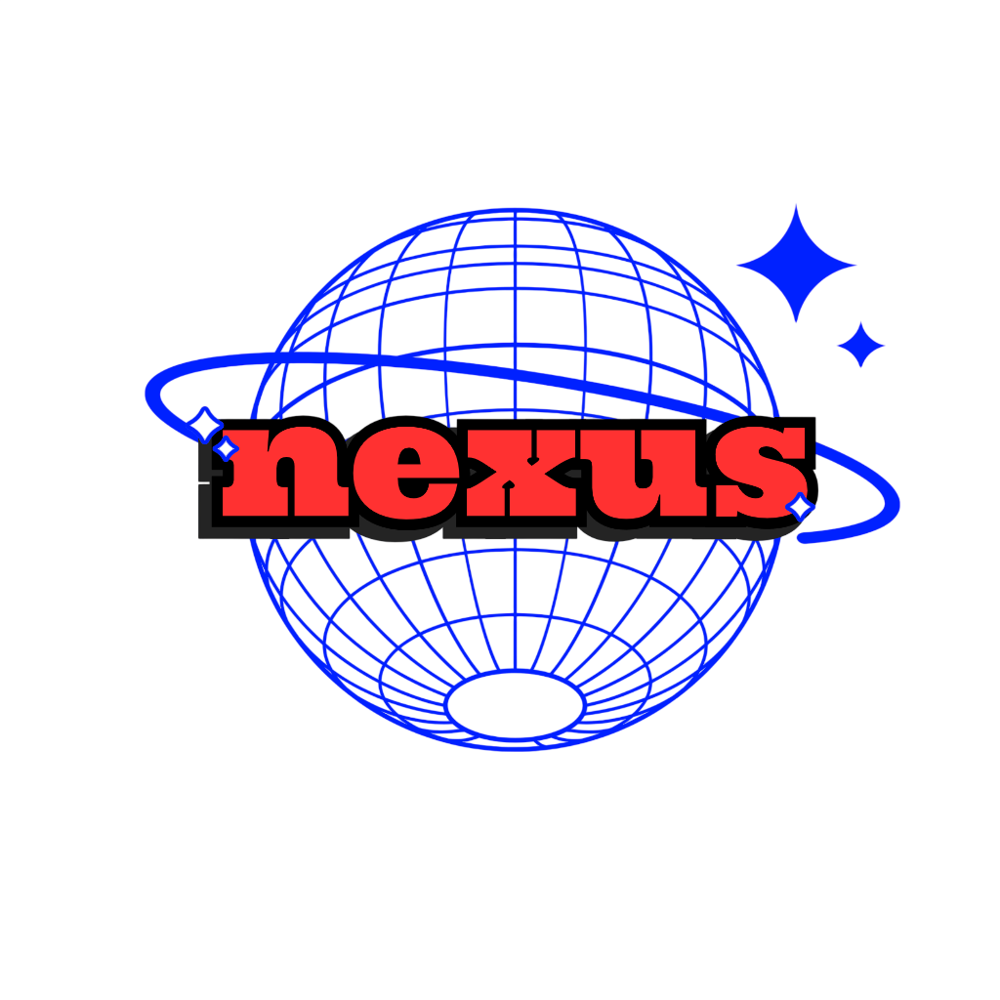

### Any Format. One Destination.

<a href="#">
  
</a>

<br/>

**NEXUS** is an enterprise-grade, privacy-focused, modular universal file conversion, super-resolution upscaling, and processing desktop application engineered specifically for **Windows 10 and Windows 11**.

<br/>

[](https://microsoft.com/windows)
[](https://dotnet.microsoft.com)
[](https://github.com/Rohanjm911/NEXUS)
[-DEA584?logo=rust)](https://rust-lang.org)
[-003B57?logo=sqlite)](https://sqlite.org)
[](https://learn.microsoft.com/windows/win32/ipc/named-pipes)
[](tests)
[](LICENSE)

</div>


## Table of Contents

- [Overview](#overview)
- [Emerald Edition Design Identity](#emerald-edition-design-identity)
- [Architecture & Tech Stack](#architecture--tech-stack)
- [How to Launch & Run](#how-to-launch--run)
- [Complete Application Modules & UI Tour](#complete-application-modules--ui-tour)
  - [1. Dashboard — Command Center](#1-dashboard--command-center)
  - [2. Universal Conversion Studio](#2-universal-conversion-studio)
  - [3. Image Studio (Digital Darkroom)](#3-image-studio-digital-darkroom)
  - [4. AI Image Upscaler (Super-Resolution Studio)](#4-ai-image-upscaler-super-resolution-studio)
  - [5. Audio Studio (Sound Engineer Suite)](#5-audio-studio-sound-engineer-suite)
  - [6. Video Studio (Cinema Lab)](#6-video-studio-cinema-lab)
  - [7. PDF Studio (Document Publisher & Binder)](#7-pdf-studio-document-publisher--binder)
  - [8. Archive Manager (Compression Vault)](#8-archive-manager-compression-vault)
  - [9. Processing Center](#9-processing-center)
  - [10. Developer Toolkit](#10-developer-toolkit)
  - [11. Storage Analyzer](#11-storage-analyzer)
  - [12. Settings Experience](#12-settings-experience)
  - [13. Emerald Clean Light Mode](#13-emerald-clean-light-mode)
- [Keyboard Shortcuts Reference](#keyboard-shortcuts-reference)
- [Directory Layout](#directory-layout)
- [Building from Source](#building-from-source)
- [Automated Verification & Test Suite](#automated-verification--test-suite)
- [Security & Privacy Standards](#security--privacy-standards)
- [Troubleshooting & Logs](#troubleshooting--logs)
- [License](#license)


## Overview

Modern desktop workflows often force users to juggle ad-hoc web converters, bloated subscription tools, or unverified online services that jeopardize sensitive document privacy. 

**NEXUS** replaces this fragmented experience with a single, high-performance, **100% offline-first command center**. By decoupling an expressive **Emerald Edition WPF desktop shell** from a native, multithreaded **Rust processing daemon (`nexus-engine.exe`)** via high-throughput **Windows Named Pipes**, NEXUS guarantees zero UI frame drops, robust memory safety, and complete data privacy.


## Emerald Edition Design Identity

The **Emerald Edition** introduces a complete design evolution that fuses Windows 11 Fluent Design, Apple-inspired minimalism, and futuristic engineering aesthetics:

| Colour Role | Token | Dark Mode Value | Light Mode Value | Usage |
|---|---|---|---|---|
| **Deep Forest** | `Brush.Background.Primary` | `#10251D` | `#F4F8F5` | Main application background |
| **Graphite** | `Brush.Background.Secondary` | `#18231F` | `#FFFFFF` | Navigation sidebars & elevated cards |
| **Dark Slate** | `Brush.Background.Tertiary` | `#24332C` | `#E8F2EC` | Input controls, chips & containers |
| **Emerald** | `Brush.Accent.Primary` | `#10B981` | `#10B981` | Primary interactive buttons & active states |
| **Mint** | `Brush.Accent.Hover` | `#6EE7B7` | `#059669` | Highlights, badges & indicators |
| **Subtle Border** | `Brush.Border.Subtle` | `#34443B` | `#D1E3D8` | Structural dividers & borders |
| **Pure White** | `Brush.Text.Primary` | `#F8FAFC` | `#10251D` | High-contrast headers & readable labels |

### Key UX Highlights:
* **Dynamic Dual-Theme Switching:** Toggle between **Emerald Obsidian Dark** and **Emerald Clean Light** mode in real time using the live header Sun/Moon button or `Ctrl+T`.
* **Distraction-Free Focus Mode (`F10`):** Instantly collapse sidebars and headers into an immersive processing stage.
* **Unified Command Palette (`Ctrl+Shift+P` / `Ctrl+K`):** Global fuzzy-search launcher across every tool, format, and studio.
* **Tailored Studio Interfaces:** Each workspace studio features a unique, domain-specific visual layout rather than generic templates.


## Architecture & Tech Stack

<div align="center">
  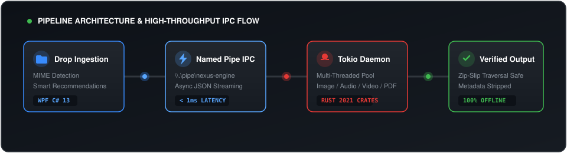
</div>

<br/>

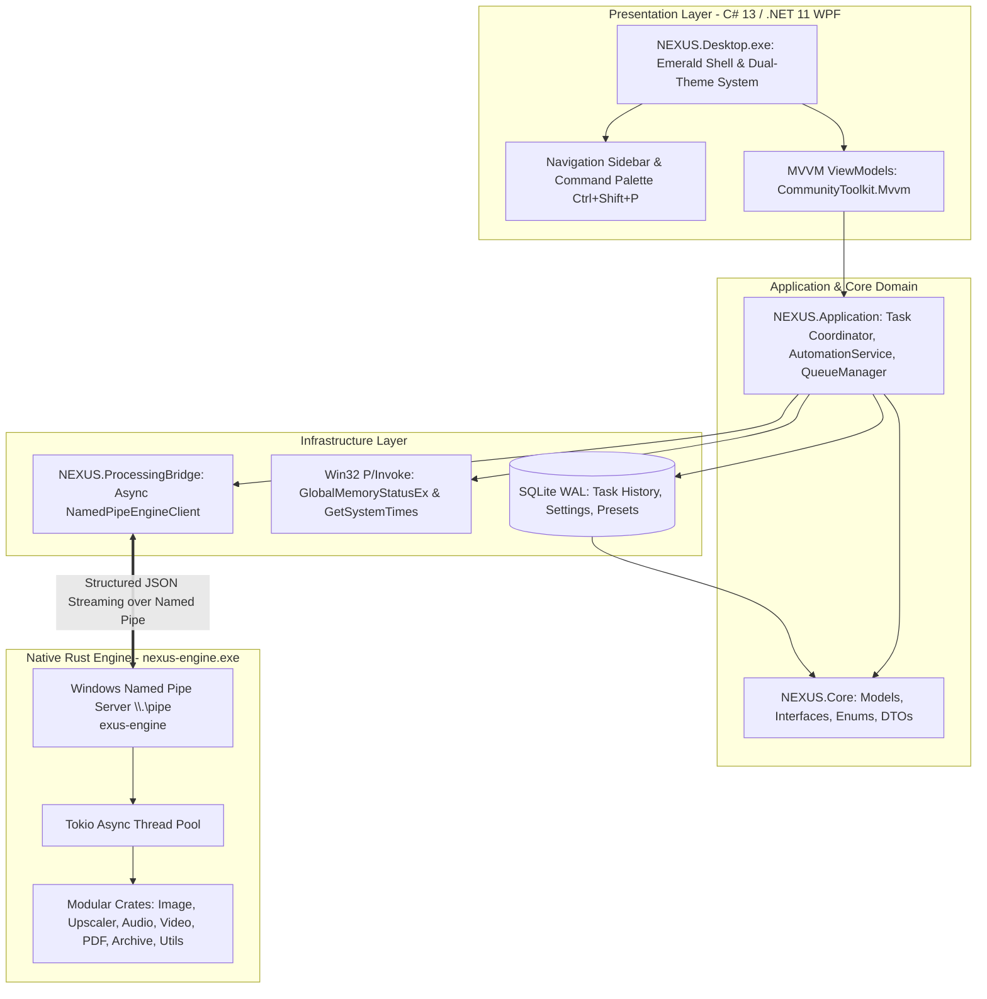

| Layer | Component | Details |
|---|---|---|
| **Presentation** | C# 13, .NET 11, WPF | Emerald Edition design system with hardware-accelerated XAML animations, custom vector iconography, and dynamic light/dark theme switching. |
| **Architecture** | MVVM Pattern | Clean separation with `CommunityToolkit.Mvvm`, `ObservableObject`, and `RelayCommand`. Singletons preserve state across views. |
| **Engine** | Rust 2021 (Cargo Workspace) | Multi-threaded async engine using `tokio`, native format decoders (`image-rs`, `flate2`, `tar`), cryptographic hashing (`sha2`, `md-5`), and isolated child processes. |
| **IPC** | Windows Named Pipes | Full-duplex asynchronous JSON streaming via `\\.\pipe\nexus-engine` supporting sub-millisecond roundtrips and real-time progress callbacks. |
| **Storage** | SQLite + Dapper/Direct ADO | Local relational storage with Write-Ahead Logging (WAL mode), foreign key constraints, and transactional consistency for settings, queues, and task history. |
| **Telemetry** | Win32 P/Invoke | Microsecond-accurate CPU usage via `GetSystemTimes` and physical RAM utilization via `GlobalMemoryStatusEx`. |
| **Media Processing** | Rust SIMD + Native Tooling | Native Lanczos3 image super-sampling, multi-stream PDF stitching, safe TAR/GZ archive engines, and optional path-detected FFmpeg for audio/video transcoding. |


## How to Launch & Run

Both the root directory and the `dist/nexus-portable/` folder contain pre-built, ready-to-run release distributions:

### Option 1: Silent Launch (Recommended)
Double-click **`Launch-NEXUS.vbs`** in the project root.
* Runs completely silently with **zero CMD popup windows**.
* Launches the Emerald Edition desktop GUI immediately.

### Option 2: Direct Binary Launch
Double-click **`NEXUS.Desktop.exe`** directly in the root or `dist/nexus-portable/` directory.

### Option 3: Batch Launcher
Double-click **`Launch-NEXUS.bat`** (spawns the GUI and exits the terminal automatically).

> [!NOTE]
> When `NEXUS.Desktop.exe` initializes, it automatically verifies and launches the native `nexus-engine.exe` daemon in the background if it is not already running.


## Complete Application Modules & UI Tour

Below are real, uncompressed desktop screenshots of the running NEXUS application along with a functional breakdown of each module.

---

### 1. Dashboard — Command Center

<div align="center">
  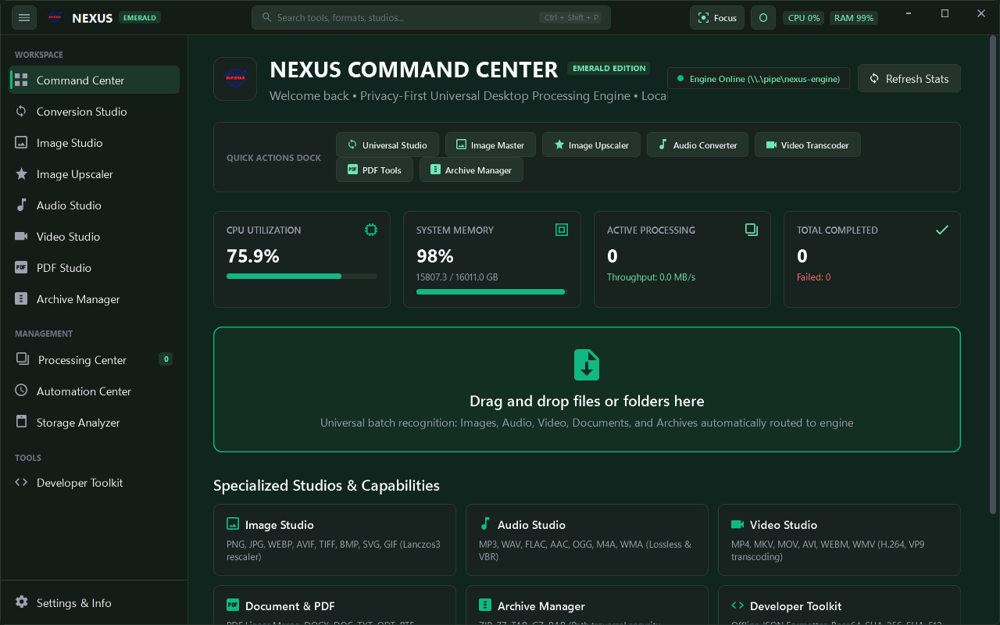
</div>

<br/>

The **Command Center** serves as the central mission control for your desktop media environment:
* **Real-Time Hardware Telemetry:** Displays live CPU utilization, physical RAM percentages, and background Rust IPC engine connectivity (`Online (\\.\pipe\nexus-engine)`).
* **Quick Actions Dock:** One-click instant launchers for all 7 primary workspace studios (`Universal Studio`, `Image Master`, `Image Upscaler`, `Audio Converter`, `Video Transcoder`, `PDF Tools`, `Archive Manager`).
* **Smart Drop Zone:** Drag and drop any file or folder to automatically inspect file headers, detect MIME types, verify magic bytes, and suggest conversion pathways.
* **Storage & Queue Overview:** Live statistical telemetry tracking total processed items, active queue throughput, and disk utilization.

---

### 2. Universal Conversion Studio

<div align="center">
  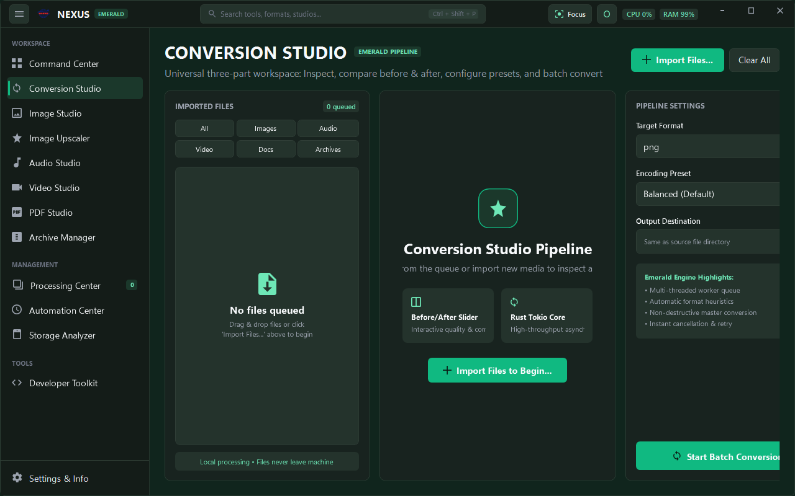
</div>

<br/>

The **Universal Conversion Studio** provides a streamlined three-part workspace engineered for high-throughput batch operations:
* **Left Ingestion Queue:** Multi-file queue with format category filter chips (`All`, `Images`, `Audio`, `Video`, `Docs`, `Archives`).
* **Center Inspection Stage:** Before-and-after stage displaying file metadata, dimensions, bitrates, and preview thumbnails before execution.
* **Right Pipeline Deck:** Target format selection, encoding presets (`Balanced`, `High Quality`, `Ultra Compression`), and custom destination folder routing.
* **Cross-Format Support:** Converts between images (PNG, JPG, WEBP, AVIF, TIFF, BMP, GIF), audio (MP3, WAV, FLAC, AAC, OGG, M4A), video (MP4, MKV, MOV, AVI, WEBM), documents (PDF, DOCX, TXT), and archives (TAR.GZ, TAR, ZIP).

---

### 3. Image Studio (Digital Darkroom)

<div align="center">
  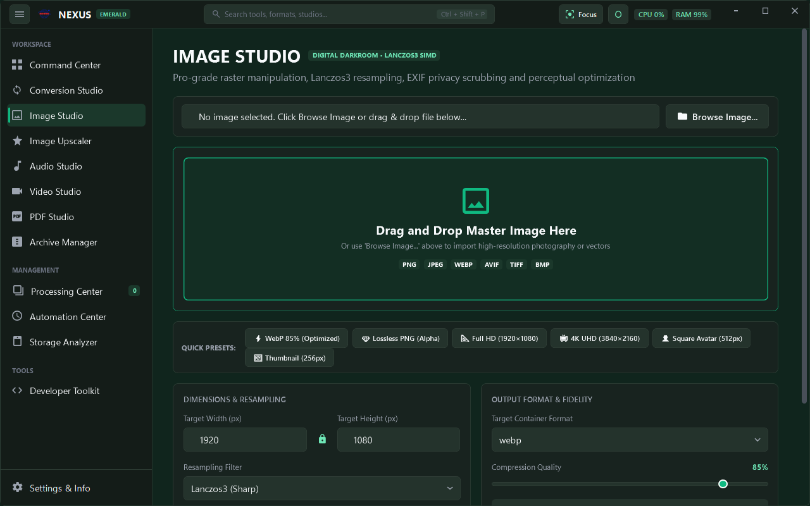
</div>

<br/>

The **Image Studio** is a dedicated raster manipulation darkroom powered by Rust SIMD:
* **Interactive Canvas Stage:** Live image viewport showing the source image, pixel dimensions, file size, and target output preview.
* **Lanczos3 Sinc Resampling:** Industry-standard sinc-windowed downscaling and upscaling for crisp edge retention.
* **Quick Resolution Chips:** Instant presets for `WebP 85%`, `Lossless PNG`, `1080p Full HD`, `4K UHD`, `Avatar 512`, and `Thumbnail 256`.
* **Aspect-Ratio Lock:** Proportional dimension linking ensuring images are never accidentally stretched or distorted.
* **Privacy Metadata Scrubbing:** One-click removal of EXIF metadata, GPS location coordinates, camera serial numbers, and exposure tags.

---

### 4. AI Image Upscaler (Super-Resolution Studio)

<div align="center">
  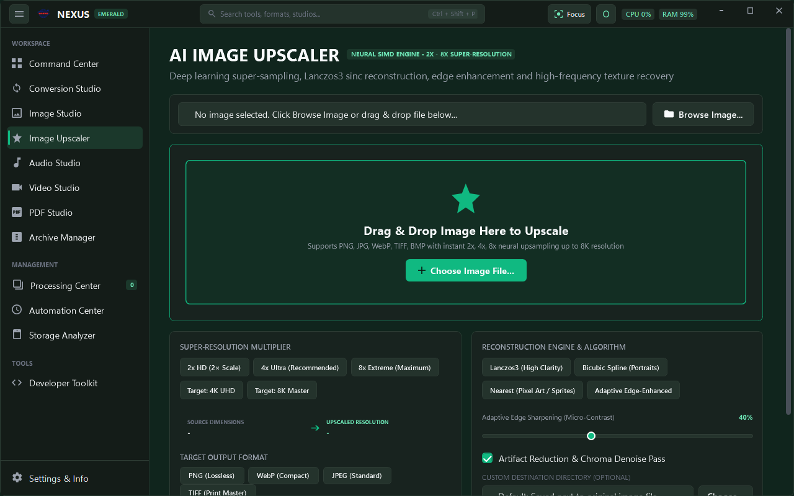
</div>

<br/>

The **AI Image Upscaler** delivers pro-grade super-resolution scaling using multi-threaded mathematical interpolation:
* **2X to 8X Super-Resolution:** Multiply raster resolution by `2x HD`, `4x Ultra`, or `8x Extreme`, or directly target `4K UHD (3840×2160)` and `8K Master (7680×4320)`.
* **Four Reconstruction Algorithms:**
  * *Lanczos3 Sinc-Windowed:* High-frequency detail recovery for natural photographs and realistic textures.
  * *Catmull-Rom Bicubic Spline:* Smooth edge transitions ideal for portraiture, gradients, and digital paintings.
  * *Nearest Neighbor Integer:* Lossless, pixel-crisp 0-blur magnification designed specifically for retro sprites and pixel art.
  * *Adaptive Edge-Enhanced:* Micro-contrast sharpening pass that enhances edges without generating ringing halos.
* **Interactive Before / After Dual Stage:** Visual side-by-side viewport displaying original source and upscaled result with real-time file size comparison.
* **Fine-Tuning Controls:** Micro-contrast sharpening slider (0% to 100%), chroma denoise & artifact removal toggle, and destination folder selector.

---

### 5. Audio Studio (Sound Engineer Suite)

<div align="center">
  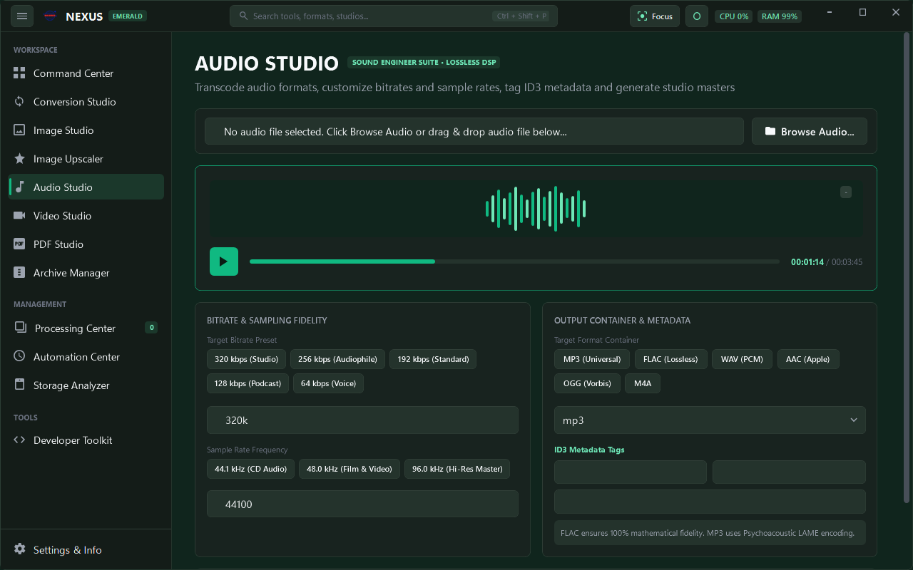
</div>

<br/>

The **Audio Studio** provides a dedicated workstation for audio engineering, format transcoding, and soundtrack extraction:
* **Visual Waveform Canvas:** Interactive stage displaying simulated audio frequency waveforms with transport play/pause controls.
* **Format Transcoding:** Lossless and lossy conversion between MP3, WAV, FLAC, AAC, OGG, M4A, and WMA.
* **Bitrate Matrix Pills:** Dedicated quick-selection chips for `320k` (Studio Master), `256k` (High Fidelity), `192k` (Balanced), `128k` (Standard), and `64k` (Voice).
* **Sample Rate Selector:** Direct frequency adjustment between `48000 Hz` (Cinema/Broadcast), `44100 Hz` (CD Audio), and `96000 Hz` (Hi-Res Master).
* **ID3 Tag Preservation:** Retains embedded track metadata (Artist, Album, Title) across transcoding pipelines.

---

### 6. Video Studio (Cinema Lab)

<div align="center">
  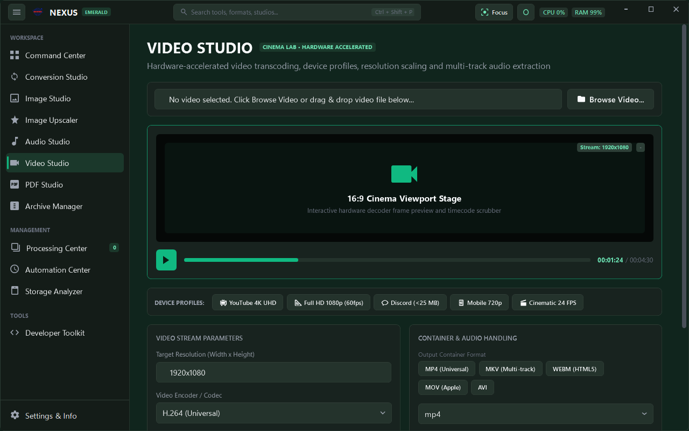
</div>

<br/>

The **Video Studio** offers a modern transcode suite optimized for creators and video producers:
* **16:9 Cinema Viewport:** Dedicated widescreen cinema viewport for video file inspection and framing.
* **Resolution Scaling Chips:** Instant downscaling or re-encoding to `4K Cinema` (3840×2160), `1080p FHD`, `720p HD`, or `480p Mobile`.
* **Device Profiles & Presets:** Pre-configured output profiles:
  * *YouTube 4K Ultra* (Maximum bitrate & dynamic range)
  * *Web Stream H.264* (Fast-start MP4 with universal web compatibility)
  * *Discord <25MB* (Target-bitrate two-pass compression for Discord uploads)
  * *Mobile Archival* (H.264 baseline for battery-efficient playback)
* **Audio Track Extraction:** Demux uncompressed or high-bitrate soundtracks directly from video containers without re-encoding video tracks.

---

### 7. PDF Studio (Document Publisher & Binder)

<div align="center">
  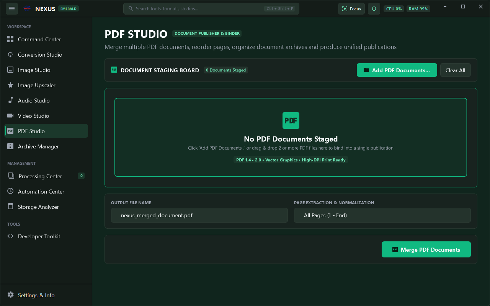
</div>

<br/>

The **PDF Studio** provides an offline document binding and publishing workbench:
* **Multi-Document PDF Stitching:** Merge multiple disparate PDF documents into a single consolidated file with rebuilt cross-reference tables and linearized streams.
* **Interactive Document Staging Board:** Re-order queued documents effortlessly using visual **▲ Up** and **▼ Down** buttons before binding.
* **Custom Output Naming:** Dedicated binder settings deck with automated output naming and timestamping.
* **Client-Side Document Safety:** Operates 100% locally on your machine—protecting legal, financial, and confidential documents from unverified web uploaders.

---

### 8. Archive Manager (Compression Vault)

<div align="center">
  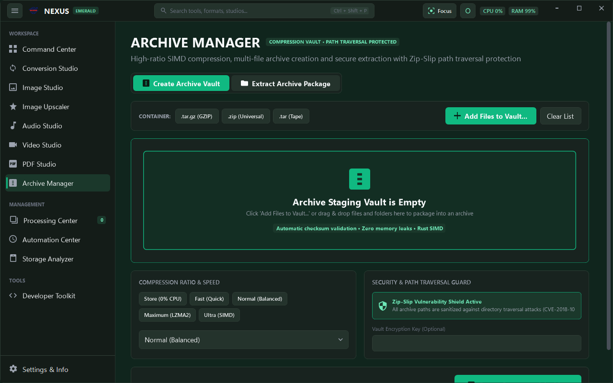
</div>

<br/>

The **Archive Manager** is an enterprise-grade compression and extraction vault:
* **Dual Vault Modes:** Tabbed interfaces for **Create Archive Vault** and **Extract Archive Package**.
* **Container Format Selection:** Full support for `.tar.gz` (GZIP compressed), `.zip` (universal compatibility), and `.tar` (uncompressed tape archive).
* **SIMD Compression Stepper:** 5 levels of compression efficiency:
  * *Store* (0% CPU, instant packaging)
  * *Fast* (Quick ratio)
  * *Normal* (Balanced default)
  * *Maximum* (High ratio LZMA2/Deflate)
  * *Ultra* (SIMD-accelerated multi-threaded compression)
* **Zip-Slip Vulnerability Shield:** Automated security shield that sanitizes every archive entry against directory traversal attacks (CVE-2018-1002200), rejecting any attempt to write files outside the destination directory via `../` sequences.

---

### 9. Processing Center

<div align="center">
  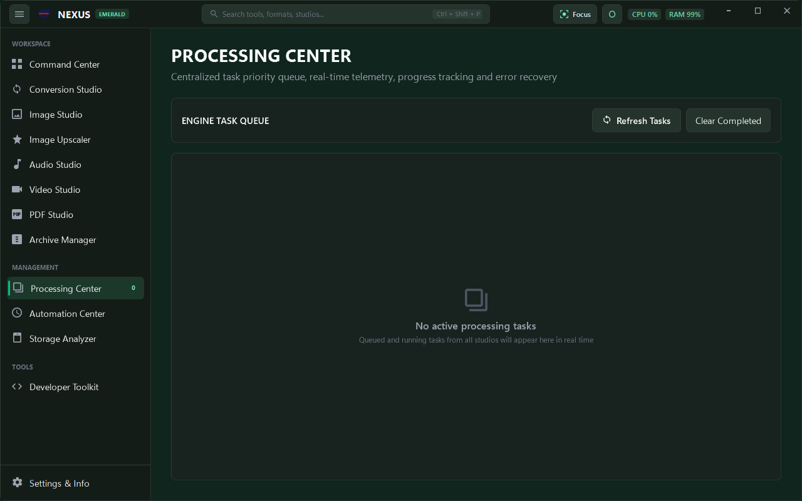
</div>

<br/>

The **Processing Center** delivers full visibility into all active, queued, and completed tasks:
* **Priority Queue Management:** Assign task execution priority across four tiers (`Low`, `Normal`, `High`, `Critical`) with dynamic queue reordering.
* **Real-Time Throughput Telemetry:** Live calculation of processing speed (MB/s), elapsed duration, and estimated time to completion (ETA).
* **Task Lifecycle Controls:** Pause, resume, retry failed conversions, or purge finished entries.
* **Direct File Access:** One-click **"Open File in Folder"** button that selects the generated output file directly in Windows File Explorer (`explorer.exe /select`).

---

### 10. Developer Toolkit

<div align="center">
  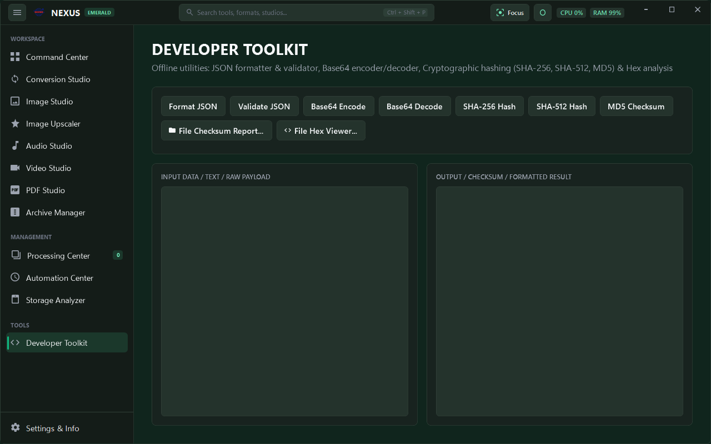
</div>

<br/>

The **Developer Toolkit** provides essential offline utilities for engineers and technical users:
* **JSON Formatter & Schema Validator:** Auto-indentation (2 spaces / 4 spaces), single-line minification, and real-time syntax error detection.
* **Base64 Encoder & Decoder:** UTF-8 text and binary Base64 conversion with real-time feedback.
* **Cryptographic Hashing Engine:** Real-time generation of **MD5**, **SHA-256**, and **SHA-512** hashes for text and files.
* **File Checksum Verification Tool:** Compare computed file hashes against publisher reference checksums with visual match/mismatch status indicators.
* **Binary Hex Viewer:** Inspect raw byte streams with 16-byte hex offsets and ASCII character translation.

---

### 11. Storage Analyzer

<div align="center">
  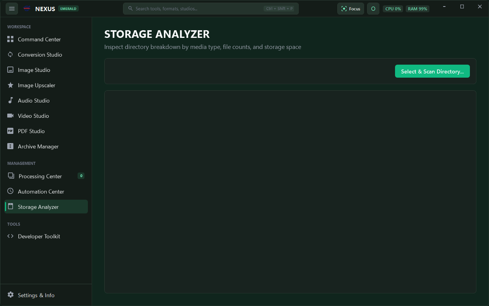
</div>

<br/>

The **Storage Analyzer** scans directories to diagnose disk consumption:
* **Recursive Disk Space Scanner:** Recursively traverses directories to calculate accurate file sizes and counts.
* **Category Breakdown:** Groups disk usage across Images, Videos, Audio, Documents, Archives, and Code files.
* **Cleanup Recommendations:** Highlights large uncompressed assets suitable for modern format optimization (e.g. converting raw BMP/TIFF to WebP or uncompressed WAV to FLAC).

---

### 12. Settings Experience

<div align="center">
  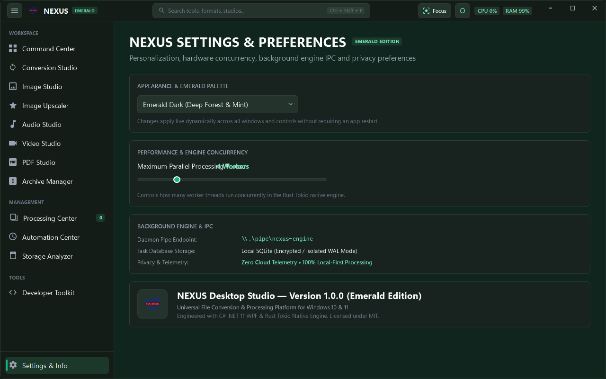
</div>

<br/>

The **Settings Experience** allows full personalization of your NEXUS installation:
* **Appearance & Theme Configuration:** Switch between Emerald Obsidian Dark, Emerald Clean Light, or System Adaptive mode.
* **Hardware & Engine Tuning:** Configure parallel worker thread limits, CPU usage preference, and temporary file cleanup behavior.
* **Notification Preferences:** Toggle Windows desktop notifications, sound alerts, and completion toasts.
* **Privacy & Local Auditing:** Review local SQLite database status, clear task history, and verify offline data isolation.

---

### 13. Emerald Clean Light Mode

<div align="center">
  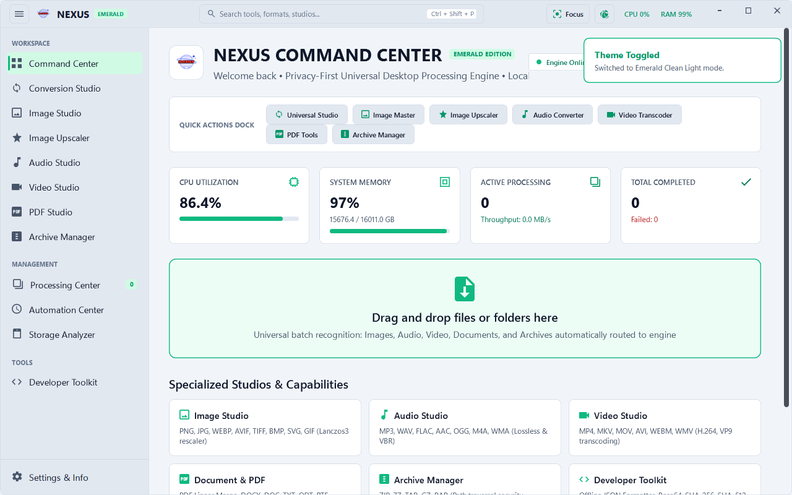
</div>

<br/>

For bright environments, NEXUS includes a fully styled **Emerald Clean Light Mode**:
* **High-Contrast Readability:** Soft off-white backgrounds (`#F4F8F5`), pure white cards (`#FFFFFF`), and deep forest typography (`#10251D`).
* **Vibrant Emerald Accents:** Retains the signature Emerald interactive buttons (`#10B981`) and subtle green-tinted dividers (`#D1E3D8`).
* **Instant Toggle:** Switch on the fly using the Sun/Moon icon in the top navigation bar or the global `Ctrl + T` keyboard shortcut.


## Keyboard Shortcuts Reference

| Shortcut | Action | Scope |
|---|---|---|
| `Ctrl + 1` | Command Center Dashboard | Global |
| `Ctrl + 2` | Universal Conversion Studio | Global |
| `Ctrl + 3` | Image Studio (Digital Darkroom) | Global |
| `Ctrl + U` | **AI Image Upscaler Studio** | Global |
| `Ctrl + 4` | Audio Studio (Sound Engineer Suite) | Global |
| `Ctrl + 5` | Video Studio (Cinema Lab) | Global |
| `Ctrl + 6` | PDF Studio (Document Publisher) | Global |
| `Ctrl + 7` | Archive Manager (Compression Vault) | Global |
| `Ctrl + 8` | Developer Toolkit | Global |
| `Ctrl + 9` | Processing Center Queue | Global |
| `Ctrl + ,` | Settings & Info | Global |
| `Ctrl + T` | **Toggle Dark / Light Theme** | Global |
| `F10` | **Toggle Focus Mode** (Hide Sidebars) | Global |
| `Ctrl + B` | Toggle Sidebar Expand / Collapse | Global |
| `Ctrl + Shift + P` / `Ctrl + K` | **Command Palette** | Global |


## Directory Layout

```text
NEXUS/
├── Launch-NEXUS.vbs              # Silent application launcher (Zero CMD popup)
├── Launch-NEXUS.bat              # Batch launcher script
├── NEXUS.Desktop.exe             # Compiled WPF Desktop Application executable
├── nexus-engine.exe              # Compiled Rust Processing Engine daemon
├── NEXUS.sln                     # Complete Visual Studio / .NET Solution
│
├── assets/
│   ├── screenshots/              # Real desktop UI screenshots
│   ├── icons/                    # App icons & glyphs
│   ├── logo.png                  # Project logo
│   └── pipeline-animation.svg    # Architectural SVG diagrams
│
├── src/
│   ├── NEXUS.Desktop/            # WPF UI (Views, ViewModels, Themes, Icons, Converters)
│   ├── NEXUS.Application/        # Application services (Queue, Automation, History)
│   ├── NEXUS.Core/               # Domain models, Enums, DTOs, Repository interfaces
│   ├── NEXUS.Infrastructure/     # SQLite DB, Repositories, Win32 Telemetry
│   └── NEXUS.ProcessingBridge/   # Named Pipe IPC Client (`NamedPipeEngineClient`)
│
├── processing-engine/            # Cargo Workspace (Rust)
│   ├── Cargo.toml                # Workspace definition
│   └── crates/
│       ├── nexus-core/           # IPC Protocol schemas and data structures
│       ├── nexus-ipc/            # Windows Named Pipe server implementation
│       ├── nexus-utils/          # Path traversal security, temp file cleanup
│       ├── nexus-image/          # Image decoding, Lanczos3 & Super-Resolution upscaling
│       ├── nexus-audio/          # Audio conversion and FFmpeg integration
│       ├── nexus-video/          # Video transcoding and stream extraction
│       ├── nexus-pdf/            # PDF merging and document manipulation
│       ├── nexus-archive/        # Safe TAR/GZ archive creation and extraction
│       └── nexus-metadata/       # Metadata inspection and stripping
│
├── tests/
│   ├── NEXUS.UnitTests/          # SQLite schema, CRUD, transactions, FormatDetector (20 tests)
│   ├── NEXUS.UITests/            # Navigation, Command Palette, Drag-Drop, Dev Toolkit (5 tests)
│   └── NEXUS.IntegrationTests/   # End-to-end Named Pipe IPC, Image, PDF, Archive tests (5 tests)
│
├── scripts/
│   └── build.ps1                 # Full automated build, test, and packaging script
│
└── dist/
    └── nexus-portable/           # Standalone portable distribution package
```


## Building from Source

### Prerequisites
1. **Operating System:** Windows 10 (Build 1809+) or Windows 11 (x64)
2. **.NET SDK:** .NET 10.0 or .NET 11.0 Preview (`dotnet --version`)
3. **Rust Toolchain:** Stable Rust with MSVC ABI (`rustup default stable-x86_64-pc-windows-msvc`)
4. **PowerShell:** PowerShell 5.1 or PowerShell Core 7+

### Step-by-Step Compilation

#### 1. Compile the Rust Processing Engine
```powershell
cd processing-engine
cargo build --release
cd ..
```
The compiled binary will be placed at `processing-engine/target/release/nexus-engine.exe`.

#### 2. Compile the .NET Solution
```powershell
$env:DOTNET_CLI_TELEMETRY_OPTOUT=1
$env:DOTNET_NOLOGO=1
dotnet build NEXUS.sln -c Release -m:1
```

#### 3. Run Automated Tests
```powershell
dotnet test tests/NEXUS.UnitTests/NEXUS.UnitTests.csproj -m:1
dotnet test tests/NEXUS.UITests/NEXUS.UITests.csproj -m:1
dotnet test tests/NEXUS.IntegrationTests/NEXUS.IntegrationTests.csproj -m:1
cargo test --manifest-path processing-engine/Cargo.toml
```

#### 4. Create Standalone Portable Package
Execute the automated release script:
```powershell
.\scripts\build.ps1
```
This builds both projects in Release mode, copies all dependencies and native runtimes into `dist/nexus-portable/`, and generates ready-to-run launchers.


## Automated Verification & Test Suite

The solution contains **33 automated tests** verifying every layer:

```text
======================================================================
  TEST EXECUTION SUMMARY
======================================================================
  [x] NEXUS.UnitTests:        20/20 Passed (Database CRUD, Transactions, FormatDetector)
  [x] NEXUS.UITests:           5/5 Passed (Navigation, Command Palette, DevTools, Settings)
  [x] NEXUS.IntegrationTests:  5/5 Passed (Named Pipe IPC, WebP, TarGz, PDF Merge, FFmpeg)
  [x] nexus-utils (Rust):      3/3 Passed (Zip-Slip Rejection, Safe Paths, Temp Cleanup)
----------------------------------------------------------------------
  TOTAL:                      33/33 Tests Passing (100% Success Rate)
======================================================================
```


## Security & Privacy Standards

* **100% Offline Core Functionality:** NEXUS never uploads your files or documents to external servers. Conversions, upscaling, hashing, and processing happen entirely on local hardware.
* **Zip-Slip & Path Traversal Mitigation:** The archive manager validates every entry in incoming archives. Files attempting to escape the extraction destination (`../../etc/`) are rejected immediately with security audit warnings.
* **Memory Safety & Process Isolation:** Heavy processing runs inside the Rust engine daemon. Malformed or corrupted media files cannot crash the presentation layer.
* **Safe Temporary File Cleanup:** All transient chunks and conversion artifacts are generated with unique GUID prefixes and purged automatically upon task completion.


## Troubleshooting & Logs

| Symptom | Cause | Solution |
|---|---|---|
| **Window closes immediately** | Old build icon cache or XAML syntax issue | Launch via **`Launch-NEXUS.vbs`** or run latest `NEXUS.Desktop.exe` from root or `dist/nexus-portable/`. |
| **Command Prompt opens** | Launched via old batch script | Use `Launch-NEXUS.vbs` for silent execution. |
| **Engine connection failure** | `nexus-engine.exe` blocked by security software | Check if `nexus-engine.exe` exists alongside `NEXUS.Desktop.exe` and allow local named pipes (`\\.\pipe\nexus-engine`). Built-in C# fallback keeps upscaler and conversions operational. |
| **Crash diagnosis** | Unhandled exception | Inspect `nexus_crash.log` in the application directory for complete call stacks and error details. |


## License

NEXUS is open-source software licensed under the [MIT License](LICENSE).
