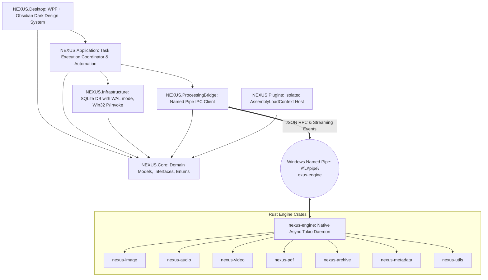

# NEXUS System Architecture

## Tagline: Any Format. One Destination.

---

## 1. High-Level Architectural Diagram



---

## 2. Layer Responsibilities

### 2.1 Presentation Layer (`NEXUS.Desktop`)
- **Technology:** C# 13 / .NET 11 / WPF with custom XAML design system.
- **Role:** Pure MVVM presentation. Renders the UI, manages navigation, provides drag-and-drop ingestion, and binds dynamically to ViewModels.
- **Constraints:** Never performs file conversion or heavy computation directly on the UI thread.

### 2.2 Application Layer (`NEXUS.Application`)
- **Technology:** .NET Dependency Injection, async coordination.
- **Key Services:**
  - `TaskExecutionService`: Enqueues and submits tasks to the processing engine, multiplexes progress updates, and updates task states in SQLite.
  - `AutomationService`: Manages `FileSystemWatcher` instances across registered watch folders, evaluates pattern filters and rules, and triggers automated tasks.
  - `FormatDetector`: Resolves mime types and format categories using magic byte header inspections and extension mappings.

### 2.3 Domain/Core Layer (`NEXUS.Core`)
- **Role:** Independent domain definitions, entity contracts, repositories, and enums (`FileCategory`, `ProcessingStatus`, `PriorityLevel`, `ThemeMode`). Zero dependencies on UI or third-party storage libraries.

### 2.4 Infrastructure Layer (`NEXUS.Infrastructure`)
- **Database:** SQLite with Write-Ahead Logging (`PRAGMA journal_mode=WAL;`), foreign key constraints, and connection pooling.
- **Hardware Telemetry:** Direct Win32 P/Invoke APIs (`GlobalMemoryStatusEx` and `GetSystemTimes`) eliminating overhead.
- **Storage Scanner:** Streaming file tree analyzer calculating storage consumption by category.

### 2.5 Processing Bridge (`NEXUS.ProcessingBridge`)
- **IPC Protocol:** Windows Named Pipe client (`\\.\pipe\nexus-engine`) using asynchronous I/O and non-blocking streaming.
- **Process Watchdog:** Automatically spawns `nexus-engine.exe` if not active, validates responsiveness with health pings, and cleanly shuts down child process trees on application exit.

### 2.6 Native Processing Engine (`processing-engine/`)
- **Technology:** Rust 2021 Cargo workspace.
- **Concurrency:** Tokio multi-threaded asynchronous runtime.
- **Crates:**
  - `nexus-core`: IPC request/response schema, task cancellation registry.
  - `nexus-utils`: Path sanitization (Zip-Slip defense), temp file generation, SHA-256 and SHA-512 hashing.
  - `nexus-image`: Native image resampling (Lanczos3), WebP/PNG/JPEG transcoding, metadata stripping.
  - `nexus-audio`: FFmpeg audio pipeline (bitrate, sample rate, format conversion).
  - `nexus-video`: FFmpeg video pipeline (transcoding, compression, audio separation).
  - `nexus-pdf`: Multi-stream PDF container generator and stitcher.
  - `nexus-archive`: Tarball creation and safe decompression.

---

## 3. Windows Named Pipe Protocol Specification

### 3.1 Pipe Name
`\\.\pipe\nexus-engine`

### 3.2 Request Schemas

#### Task Submission (`submit`)
```json
{
  "command": "submit",
  "task": {
    "id": "7f09f067-1fa6-407b-84a2-3f8c87ad62d2",
    "name": "Transcode Audio",
    "source_path": "C:\\input.wav",
    "output_path": "C:\\output.mp3",
    "source_format": "wav",
    "target_format": "mp3",
    "category": "2",
    "options_json": "{\"bitrate\":\"320k\",\"sample_rate\":\"44100\"}"
  }
}
```

#### Health Ping (`ping`)
```json
{
  "command": "ping"
}
```

#### Task Cancellation (`cancel`)
```json
{
  "command": "cancel",
  "task_id": "7f09f067-1fa6-407b-84a2-3f8c87ad62d2"
}
```

### 3.3 Streaming Progress Response Schema
Each event is sent as a newline-delimited JSON payload over the pipe:
```json
{
  "task_id": "7f09f067-1fa6-407b-84a2-3f8c87ad62d2",
  "status": "Processing",
  "progress_percentage": 45.0,
  "speed_bytes_per_sec": 15420100.0,
  "processed_bytes": 4500000,
  "total_bytes": 10000000,
  "message": "Transcoding audio stream..."
}
```
Status transitions: `Queued` &rarr; `Processing` &rarr; `Completed` | `Failed` | `Cancelled`.

---

## 4. SQLite Database Schema

```sql
CREATE TABLE IF NOT EXISTS Tasks (
    Id TEXT PRIMARY KEY,
    Name TEXT NOT NULL,
    SourceFilePath TEXT NOT NULL,
    OutputFilePath TEXT NOT NULL,
    SourceFormat TEXT NOT NULL,
    TargetFormat TEXT NOT NULL,
    Category INTEGER NOT NULL,
    Status INTEGER NOT NULL,
    ProgressPercentage REAL NOT NULL DEFAULT 0,
    SpeedBytesPerSec REAL NOT NULL DEFAULT 0,
    FileSizeBytes INTEGER NOT NULL DEFAULT 0,
    OutputSizeBytes INTEGER NOT NULL DEFAULT 0,
    Priority INTEGER NOT NULL DEFAULT 1,
    ErrorMessage TEXT,
    CreatedAt TEXT NOT NULL,
    StartedAt TEXT,
    CompletedAt TEXT,
    OptionsJson TEXT NOT NULL DEFAULT '{}'
);

CREATE TABLE IF NOT EXISTS Presets (
    Id TEXT PRIMARY KEY,
    Name TEXT NOT NULL,
    Category INTEGER NOT NULL,
    TargetFormat TEXT NOT NULL,
    Quality INTEGER NOT NULL DEFAULT 85,
    Resolution TEXT,
    Bitrate TEXT,
    CompressionLevel INTEGER NOT NULL DEFAULT 6,
    CustomArguments TEXT,
    IsDefault INTEGER NOT NULL DEFAULT 0,
    CreatedAt TEXT NOT NULL
);

CREATE TABLE IF NOT EXISTS WatchFolders (
    Id TEXT PRIMARY KEY,
    Path TEXT NOT NULL UNIQUE,
    IsRecursive INTEGER NOT NULL DEFAULT 1,
    IsActive INTEGER NOT NULL DEFAULT 1,
    CreatedAt TEXT NOT NULL,
    LastScanAt TEXT
);

CREATE TABLE IF NOT EXISTS Settings (
    Key TEXT PRIMARY KEY,
    Value TEXT NOT NULL,
    UpdatedAt TEXT NOT NULL
);
```
